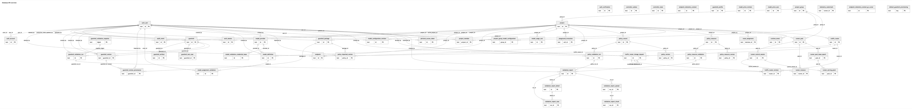
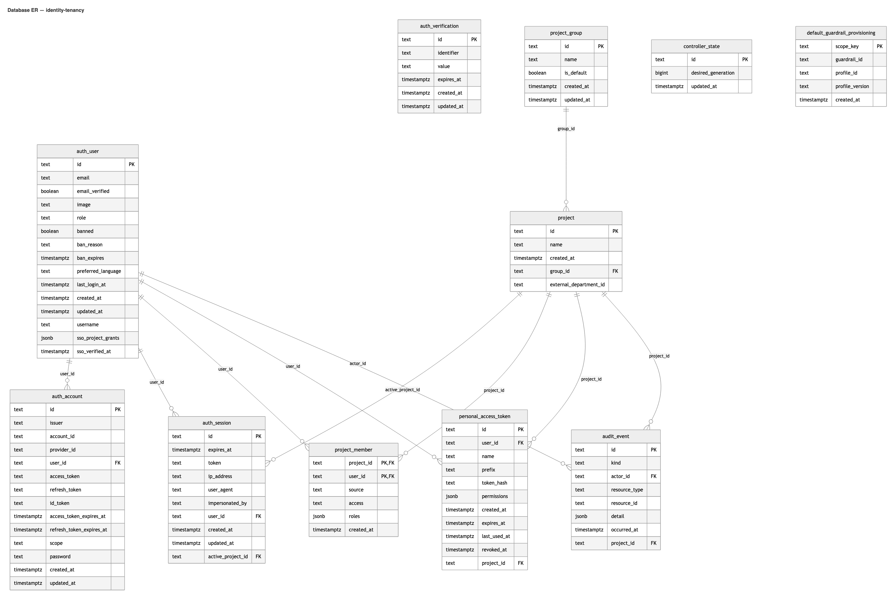
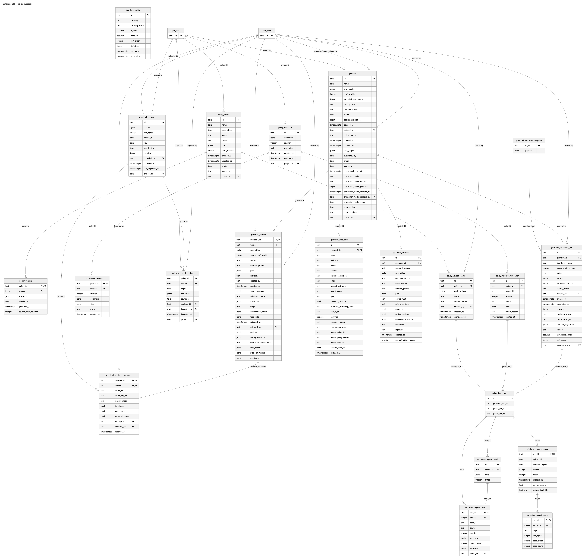
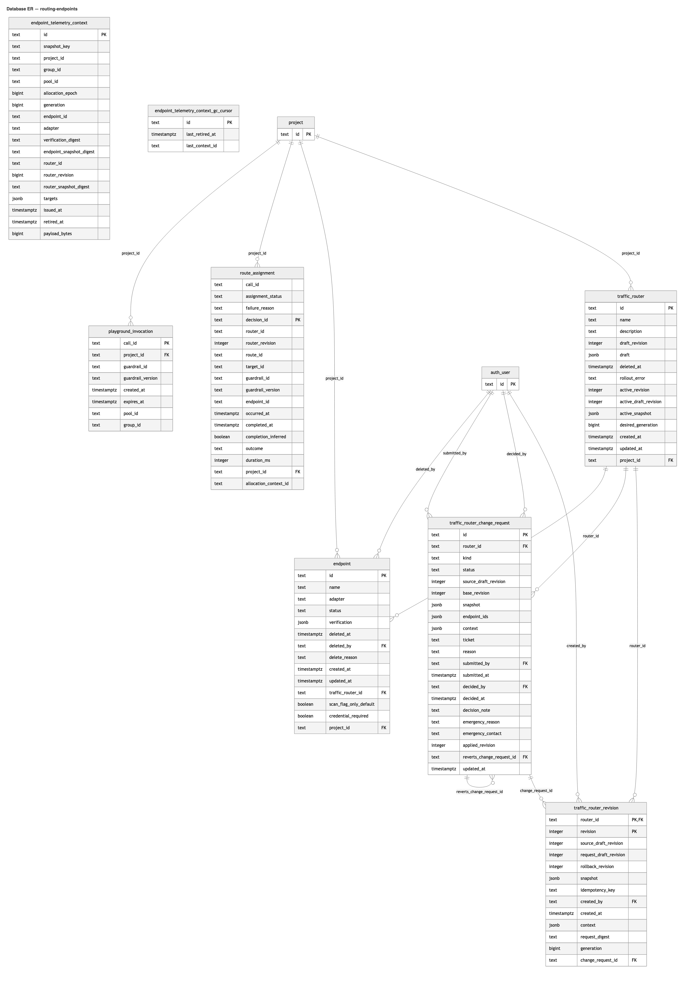
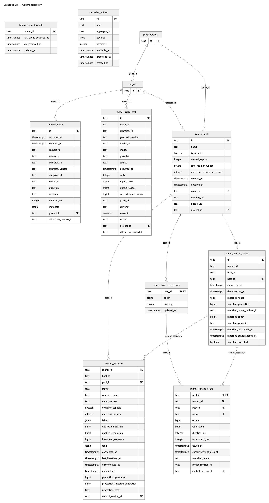
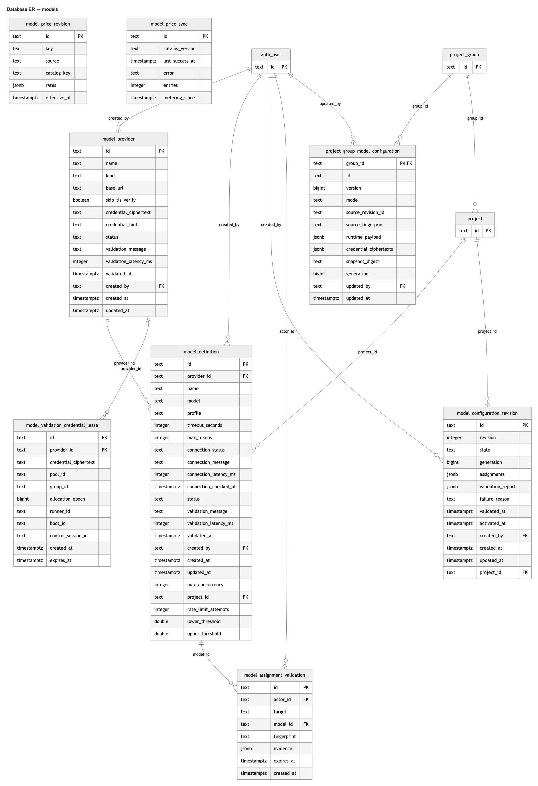

# Database ER diagram

Current schema after migrations `0000`–`0005`: **57 tables, 631 columns**. Dropped tables (`runner_telemetry_wal`, `runner_telemetry_capability`, `resource_share`) are excluded. PK/FK columns are marked; indexes and triggers are omitted.

## Overview



The full-resolution overview is [00-overview-full.png](er/00-overview-full.png). It is a wide single-row diagram; the domain diagrams below are easier to read.

## Domain diagrams

- Identity and tenancy: 11 tables
- Policies, Guardrails and testing reports: 21 tables
- Routers, Endpoints and routing: 8 tables
- Runtime, telemetry and Runners: 9 tables
- Models and pricing: 8 tables

### Identity and tenancy



### Policies, Guardrails and testing reports



### Routers, Endpoints and routing



### Runtime, telemetry and Runners



### Models and pricing



## Full Mermaid source

```mermaid
erDiagram
    audit_event {
        text id PK
        text kind
        text actor_id FK
        text resource_type
        text resource_id
        jsonb detail
        timestamptz occurred_at
        text project_id FK
    }
    auth_account {
        text id PK
        text issuer
        text account_id
        text provider_id
        text user_id FK
        text access_token
        text refresh_token
        text id_token
        timestamptz access_token_expires_at
        timestamptz refresh_token_expires_at
        text scope
        text password
        timestamptz created_at
        timestamptz updated_at
    }
    auth_session {
        text id PK
        timestamptz expires_at
        text token
        text ip_address
        text user_agent
        text impersonated_by
        text user_id FK
        timestamptz created_at
        timestamptz updated_at
        text active_project_id FK
    }
    auth_user {
        text id PK
        text email
        boolean email_verified
        text image
        text role
        boolean banned
        text ban_reason
        timestamptz ban_expires
        text preferred_language
        timestamptz last_login_at
        timestamptz created_at
        timestamptz updated_at
        text username
        jsonb sso_project_grants
        timestamptz sso_verified_at
    }
    auth_verification {
        text id PK
        text identifier
        text value
        timestamptz expires_at
        timestamptz created_at
        timestamptz updated_at
    }
    controller_outbox {
        text id PK
        text kind
        text aggregate_id
        jsonb payload
        integer attempts
        timestamptz available_at
        timestamptz processed_at
        timestamptz created_at
    }
    controller_state {
        text id PK
        bigint desired_generation
        timestamptz updated_at
    }
    endpoint {
        text id PK
        text name
        text adapter
        text status
        jsonb verification
        timestamptz deleted_at
        text deleted_by FK
        text delete_reason
        timestamptz created_at
        timestamptz updated_at
        text traffic_router_id FK
        boolean scan_flag_only_default
        boolean credential_required
        text project_id FK
    }
    endpoint_telemetry_context {
        text id PK
        text snapshot_key
        text project_id
        text group_id
        text pool_id
        bigint allocation_epoch
        bigint generation
        text endpoint_id
        text adapter
        text verification_digest
        text endpoint_snapshot_digest
        text router_id
        bigint router_revision
        text router_snapshot_digest
        jsonb targets
        timestamptz issued_at
        timestamptz retired_at
        bigint payload_bytes
    }
    guardrail {
        text id PK
        text name
        jsonb draft_config
        integer draft_revision
        jsonb excluded_test_case_ids
        text logging_level
        text runtime_profile
        text status
        bigint desired_generation
        timestamptz deleted_at
        text deleted_by FK
        text delete_reason
        timestamptz created_at
        timestamptz updated_at
        jsonb copy_origin
        text duplicate_key
        text origin
        text source_id
        timestamptz operational_reset_at
        text protection_mode
        text protection_mode_applied
        bigint protection_mode_generation
        timestamptz protection_mode_updated_at
        text protection_mode_updated_by FK
        text protection_mode_reason
        text creation_key
        text creation_digest
        text project_id FK
    }
    guardrail_artifact {
        text id PK
        text guardrail_id FK
        text guardrail_version
        bigint generation
        text compiler_version
        text nemo_version
        text runtime_profile
        jsonb plan
        text config_yaml
        text colang_content
        jsonb prompts
        jsonb action_bindings
        jsonb dependency_manifest
        text checksum
        text signature
        timestamptz created_at
        smallint content_digest_version
    }
    guardrail_package {
        text id PK
        bytea content
        integer size_bytes
        text source_id
        text key_id
        text guardrail_id
        jsonb manifest
        text uploaded_by FK
        timestamptz uploaded_at
        timestamptz last_imported_at
        text project_id FK
    }
    guardrail_profile {
        text id PK
        text category
        text category_name
        boolean is_default
        boolean enabled
        integer sort_order
        jsonb definition
        timestamptz created_at
        timestamptz updated_at
    }
    guardrail_test_case {
        text id PK
        text guardrail_id PK, FK
        text name
        text policy_id
        text phase
        text content
        text expected_decision
        text origin
        text trusted_instruction
        text target_source
        text query
        jsonb grounding_sources
        text expected_reasoning_result
        text case_type
        boolean required
        text expected_failure
        text concurrency_group
        text source_policy_id
        text source_policy_version
        text source_case_id
        jsonb covered_rule_ids
        timestamptz updated_at
    }
    guardrail_validation_run {
        text id PK
        text guardrail_id FK
        text guardrail_version
        integer source_draft_revision
        text status
        jsonb metrics
        jsonb excluded_case_ids
        text failure_reason
        text created_by FK
        timestamptz created_at
        timestamptz completed_at
        jsonb progress
        text candidate_digest
        text test_suite_digest
        jsonb runtime_fingerprint
        text subject
        boolean test_model_rules
        jsonb test_scope
        text snapshot_digest FK
    }
    guardrail_validation_snapshot {
        text digest PK
        jsonb payload
    }
    guardrail_version {
        text guardrail_id PK, FK
        text version PK
        bigint generation
        integer source_draft_revision
        text status
        text runtime_profile
        jsonb plan
        text artifact_id
        text created_by FK
        timestamptz created_at
        jsonb source_snapshot
        text validation_run_id
        jsonb inspection
        text origin
        jsonb environment_check
        jsonb test_suite
        timestamptz released_at
        text released_by FK
        jsonb policies
        jsonb testing_evidence
        text source_validation_run_id
        jsonb test_waiver
        jsonb platform_release
        jsonb publication
    }
    guardrail_version_provenance {
        text guardrail_id PK, FK
        text version PK, FK
        text source_id
        text source_key_id
        text content_digest
        jsonb file_digests
        jsonb requirements
        jsonb source_signature
        text package_id FK
        text imported_by FK
        timestamptz imported_at
    }
    model_assignment_validation {
        text id PK
        text actor_id FK
        text target
        text model_id FK
        text fingerprint
        jsonb evidence
        timestamptz expires_at
        timestamptz created_at
    }
    model_configuration_revision {
        text id PK
        integer revision
        text state
        bigint generation
        jsonb assignments
        jsonb validation_report
        text failure_reason
        timestamptz validated_at
        timestamptz activated_at
        text created_by FK
        timestamptz created_at
        timestamptz updated_at
        text project_id FK
    }
    model_definition {
        text id PK
        text provider_id FK
        text name
        text model
        text profile
        integer timeout_seconds
        integer max_tokens
        text connection_status
        text connection_message
        integer connection_latency_ms
        timestamptz connection_checked_at
        text status
        text validation_message
        integer validation_latency_ms
        timestamptz validated_at
        text created_by FK
        timestamptz created_at
        timestamptz updated_at
        integer max_concurrency
        text project_id FK
        integer rate_limit_attempts
        double lower_threshold
        double upper_threshold
        text laya_request_mode
    }
    model_price_revision {
        text id PK
        text key
        text source
        text catalog_key
        jsonb rates
        timestamptz effective_at
    }
    model_price_sync {
        text id PK
        text catalog_version
        timestamptz last_success_at
        text error
        integer entries
        timestamptz metering_since
    }
    model_provider {
        text id PK
        text name
        text kind
        text base_url
        boolean skip_tls_verify
        text credential_ciphertext
        text credential_hint
        text status
        text validation_message
        integer validation_latency_ms
        timestamptz validated_at
        text created_by FK
        timestamptz created_at
        timestamptz updated_at
    }
    model_usage_cost {
        text id PK
        text event_id
        text guardrail_id
        text guardrail_version
        text model_id
        text model
        text provider
        text source
        timestamptz occurred_at
        integer calls
        bigint input_tokens
        bigint output_tokens
        bigint cached_input_tokens
        text price_id
        text currency
        numeric amount
        text reason
        text project_id FK
        text allocation_context_id
    }
    model_validation_credential_lease {
        text id PK
        text provider_id FK
        text credential_ciphertext
        text pool_id
        text group_id
        bigint allocation_epoch
        text runner_id
        text boot_id
        text control_session_id
        timestamptz created_at
        timestamptz expires_at
    }
    personal_access_token {
        text id PK
        text user_id FK
        text name
        text prefix
        text token_hash
        jsonb permissions
        timestamptz created_at
        timestamptz expires_at
        timestamptz last_used_at
        timestamptz revoked_at
        text project_id FK
    }
    playground_invocation {
        text call_id PK
        text project_id FK
        text guardrail_id
        text guardrail_version
        timestamptz created_at
        timestamptz expires_at
        text pool_id
        text group_id
    }
    policy_imported_version {
        text policy_id PK
        text version PK
        text digest
        jsonb definition
        text source_id
        text package_id FK
        text imported_by FK
        timestamptz imported_at
        text project_id FK
    }
    policy_record {
        text id PK
        text name
        text description
        text source
        text owner
        jsonb draft
        integer draft_revision
        timestamptz created_at
        timestamptz updated_at
        text origin
        text source_id
        text project_id FK
    }
    policy_resource {
        text id PK
        jsonb definition
        integer revision
        text maintainer
        timestamptz created_at
        timestamptz updated_at
        text project_id FK
    }
    policy_resource_validation {
        text id PK
        text policy_id FK
        text parent_id
        integer revision
        text status
        jsonb tests
        text failure_reason
        timestamptz created_at
    }
    policy_resource_version {
        text policy_id PK, FK
        text version PK
        integer revision
        jsonb definition
        jsonb view
        text digest
        timestamptz created_at
    }
    policy_validation_run {
        text id PK
        text policy_id FK
        integer draft_revision
        text status
        text failure_reason
        text created_by FK
        timestamptz created_at
        timestamptz completed_at
    }
    policy_version {
        text policy_id PK, FK
        integer version PK
        jsonb snapshot
        text checksum
        timestamptz published_at
        integer source_draft_revision
    }
    project {
        text id PK
        text name
        timestamptz created_at
        text group_id FK
        text external_department_id
    }
    project_group {
        text id PK
        text name
        boolean is_default
        timestamptz created_at
        timestamptz updated_at
    }
    project_group_model_configuration {
        text group_id PK, FK
        text id
        bigint version
        text mode
        text source_revision_id
        text source_fingerprint
        jsonb runtime_payload
        jsonb credential_ciphertexts
        text snapshot_digest
        bigint generation
        text updated_by FK
        timestamptz updated_at
    }
    project_member {
        text project_id PK, FK
        text user_id PK, FK
        text source
        text access
        jsonb roles
        timestamptz created_at
    }
    route_assignment {
        text call_id
        text assignment_status
        text failure_reason
        text decision_id PK
        text router_id
        integer router_revision
        text route_id
        text target_id
        text guardrail_id
        text guardrail_version
        text endpoint_id
        timestamptz occurred_at
        timestamptz completed_at
        boolean completion_inferred
        text outcome
        integer duration_ms
        text project_id FK
        text allocation_context_id
    }
    runner_control_session {
        text id PK
        text runner_id
        text boot_id
        text pool_id FK
        timestamptz connected_at
        timestamptz disconnected_at
        text snapshot_nonce
        bigint snapshot_generation
        text snapshot_model_revision_id
        bigint snapshot_epoch
        text snapshot_group_id
        timestamptz snapshot_dispatched_at
        timestamptz snapshot_acknowledged_at
        boolean snapshot_accepted
    }
    runner_instance {
        text runner_id PK
        text boot_id
        text pool_id FK
        text status
        text runner_version
        text nemo_version
        boolean compiler_capable
        integer max_concurrency
        jsonb labels
        bigint desired_generation
        bigint applied_generation
        bigint heartbeat_sequence
        jsonb load
        timestamptz connected_at
        timestamptz last_heartbeat_at
        timestamptz disconnected_at
        timestamptz updated_at
        bigint protection_generation
        bigint protection_rejected_generation
        text protection_error
        text control_session_id FK
    }
    runner_pool {
        text id PK
        text name
        boolean is_default
        integer desired_replicas
        double safe_rps_per_runner
        integer max_concurrency_per_runner
        timestamptz created_at
        timestamptz updated_at
        text group_id FK
        text runtime_url
        text public_url
        text project_id FK
    }
    runner_pool_lease_epoch {
        text pool_id PK, FK
        bigint epoch
        boolean draining
        timestamptz updated_at
    }
    runner_serving_grant {
        text pool_id PK, FK
        text runner_id PK
        text boot_id PK
        text nonce PK
        bigint epoch
        bigint generation
        integer duration_ms
        integer uncertainty_ms
        timestamptz issued_at
        timestamptz conservative_expires_at
        text snapshot_nonce
        text model_revision_id
        text control_session_id FK
    }
    runtime_event {
        text id PK
        timestamptz occurred_at
        timestamptz received_at
        text request_id
        text runner_id
        text guardrail_id
        text guardrail_version
        text endpoint_id
        text router_id
        text direction
        text decision
        integer duration_ms
        jsonb metadata
        text project_id FK
        text allocation_context_id
    }
    telemetry_watermark {
        text runner_id PK
        timestamptz last_event_occurred_at
        timestamptz last_received_at
        timestamptz updated_at
    }
    traffic_router {
        text id PK
        text name
        text description
        integer draft_revision
        jsonb draft
        timestamptz deleted_at
        text rollout_error
        integer active_revision
        integer active_draft_revision
        jsonb active_snapshot
        bigint desired_generation
        timestamptz created_at
        timestamptz updated_at
        text project_id FK
    }
    traffic_router_change_request {
        text id PK
        text router_id FK
        text kind
        text status
        integer source_draft_revision
        integer base_revision
        jsonb snapshot
        jsonb endpoint_ids
        jsonb context
        text ticket
        text reason
        text submitted_by FK
        timestamptz submitted_at
        text decided_by FK
        timestamptz decided_at
        text decision_note
        text emergency_reason
        text emergency_contact
        integer applied_revision
        text reverts_change_request_id FK
        timestamptz updated_at
    }
    traffic_router_revision {
        text router_id PK, FK
        integer revision PK
        integer source_draft_revision
        integer request_draft_revision
        integer rollback_revision
        jsonb snapshot
        text idempotency_key
        text created_by FK
        timestamptz created_at
        jsonb context
        text request_digest
        bigint generation
        text change_request_id FK
    }
    validation_report {
        text id PK
        text guardrail_run_id FK
        text policy_run_id FK
        text policy_job_id FK
    }
    validation_report_case {
        text run_id PK, FK
        integer ordinal PK
        text case_id
        text status
        integer priority
        jsonb summary
        integer detail_bytes
        jsonb assessment
        text detail_id FK
    }
    validation_report_chunk {
        text run_id PK, FK
        integer sequence PK
        text digest
        integer raw_bytes
        integer case_offset
        integer case_count
    }
    validation_report_detail {
        text id PK
        text owner_id FK
        jsonb body
        integer bytes
    }
    validation_report_upload {
        text run_id PK, FK
        text upload_id
        text manifest_digest
        integer chunks
        integer cases
        timestamptz created_at
        text runner_boot_id
        text_array retired_boot_ids
    }
    endpoint_telemetry_context_gc_cursor {
        text id PK
        timestamptz last_retired_at
        text last_context_id
    }
    default_guardrail_provisioning {
        text scope_key PK
        text guardrail_id
        text profile_id
        text profile_version
        timestamptz created_at
    }
    auth_user ||--o{ audit_event : "actor_id"
    project ||--o{ audit_event : "project_id"
    auth_user ||--o{ auth_account : "user_id"
    project ||--o{ auth_session : "active_project_id"
    auth_user ||--o{ auth_session : "user_id"
    auth_user ||--o{ endpoint : "deleted_by"
    project ||--o{ endpoint : "project_id"
    traffic_router ||--o{ endpoint : "traffic_router_id"
    auth_user ||--o{ guardrail : "deleted_by"
    auth_user ||--o{ guardrail : "protection_mode_updated_by"
    project ||--o{ guardrail : "project_id"
    guardrail ||--o{ guardrail_artifact : "guardrail_id"
    project ||--o{ guardrail_package : "project_id"
    auth_user ||--o{ guardrail_package : "uploaded_by"
    guardrail ||--o{ guardrail_test_case : "guardrail_id"
    auth_user ||--o{ guardrail_validation_run : "created_by"
    guardrail ||--o{ guardrail_validation_run : "guardrail_id"
    guardrail_validation_snapshot ||--o{ guardrail_validation_run : "snapshot_digest"
    auth_user ||--o{ guardrail_version : "created_by"
    guardrail ||--o{ guardrail_version : "guardrail_id"
    auth_user ||--o{ guardrail_version : "released_by"
    guardrail_version ||--o{ guardrail_version_provenance : "guardrail_id, version"
    auth_user ||--o{ guardrail_version_provenance : "imported_by"
    guardrail_package ||--o{ guardrail_version_provenance : "package_id"
    auth_user ||--o{ model_assignment_validation : "actor_id"
    model_definition ||--o{ model_assignment_validation : "model_id"
    auth_user ||--o{ model_configuration_revision : "created_by"
    project ||--o{ model_configuration_revision : "project_id"
    auth_user ||--o{ model_definition : "created_by"
    model_provider ||--o{ model_definition : "provider_id"
    project ||--o{ model_definition : "project_id"
    auth_user ||--o{ model_provider : "created_by"
    project ||--o{ model_usage_cost : "project_id"
    model_provider ||--o{ model_validation_credential_lease : "provider_id"
    project ||--o{ personal_access_token : "project_id"
    auth_user ||--o{ personal_access_token : "user_id"
    project ||--o{ playground_invocation : "project_id"
    auth_user ||--o{ policy_imported_version : "imported_by"
    guardrail_package ||--o{ policy_imported_version : "package_id"
    project ||--o{ policy_imported_version : "project_id"
    project ||--o{ policy_record : "project_id"
    project ||--o{ policy_resource : "project_id"
    policy_resource ||--o{ policy_resource_validation : "policy_id"
    policy_resource ||--o{ policy_resource_version : "policy_id"
    auth_user ||--o{ policy_validation_run : "created_by"
    policy_record ||--o{ policy_validation_run : "policy_id"
    policy_record ||--o{ policy_version : "policy_id"
    project_group ||--o{ project : "group_id"
    project_group ||--o{ project_group_model_configuration : "group_id"
    auth_user ||--o{ project_group_model_configuration : "updated_by"
    project ||--o{ project_member : "project_id"
    auth_user ||--o{ project_member : "user_id"
    project ||--o{ route_assignment : "project_id"
    runner_pool ||--o{ runner_control_session : "pool_id"
    runner_control_session ||--o{ runner_instance : "control_session_id"
    runner_pool ||--o{ runner_instance : "pool_id"
    project_group ||--o{ runner_pool : "group_id"
    project ||--o{ runner_pool : "project_id"
    runner_pool ||--o{ runner_pool_lease_epoch : "pool_id"
    runner_control_session ||--o{ runner_serving_grant : "control_session_id"
    runner_pool_lease_epoch ||--o{ runner_serving_grant : "pool_id"
    project ||--o{ runtime_event : "project_id"
    project ||--o{ traffic_router : "project_id"
    auth_user ||--o{ traffic_router_change_request : "decided_by"
    traffic_router_change_request ||--o{ traffic_router_change_request : "reverts_change_request_id"
    traffic_router ||--o{ traffic_router_change_request : "router_id"
    auth_user ||--o{ traffic_router_change_request : "submitted_by"
    traffic_router_change_request ||--o{ traffic_router_revision : "change_request_id"
    auth_user ||--o{ traffic_router_revision : "created_by"
    traffic_router ||--o{ traffic_router_revision : "router_id"
    guardrail_validation_run ||--o{ validation_report : "guardrail_run_id"
    policy_resource_validation ||--o{ validation_report : "policy_job_id"
    policy_validation_run ||--o{ validation_report : "policy_run_id"
    validation_report_detail ||--o{ validation_report_case : "detail_id"
    validation_report ||--o{ validation_report_case : "run_id"
    validation_report_upload ||--o{ validation_report_chunk : "run_id"
    validation_report ||--o{ validation_report_detail : "owner_id"
    validation_report ||--o{ validation_report_upload : "run_id"
```
