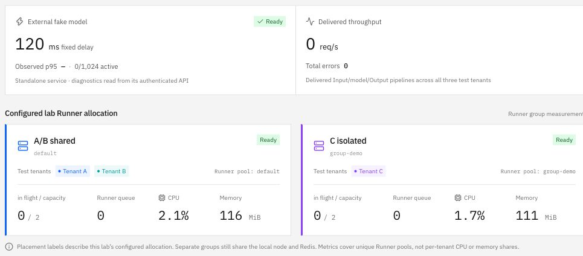

# Local Kubernetes runtime — 5 November 2026

All ten application Pods are now Ready in local Kubernetes. The fake LLM and
three LiteLLM gateways no longer run as native macOS application processes.
Guard is available at http://localhost:38081; the
[tenant load lab](http://localhost:38081/settings/tenant-load-lab) is paused after
verification. Resume it to conduct a new test.

Raw JSON/TXT observations are preserved locally in the ignored directory
`.tasklattice-recovery/local-k8s-evidence-2026-11-05/`. Artifact filenames below
refer to that local evidence: repository conventions keep generated runtime
and Kubernetes state outside Git. The two curated screenshots remain in this
documentation.

The earlier connection failed because localhost access depended on a
session-owned port-forward. The earlier fake model and gateway processes were
also session-owned. Guard itself originally remained healthy in Kubernetes.
A persistent launchd network bridge now maintains browser access independently
of the chat session.

## What runs where

| Component | Current placement |
| --- | --- |
| Controller and portal | Kubernetes Deployment `mt-demo-controller` |
| A/B Runner pool | Kubernetes StatefulSet `mt-demo-runner` |
| C Runner pool | Kubernetes StatefulSet `mt-demo-runner-group-demo` |
| PostgreSQL | Kubernetes StatefulSet; existing data retained |
| Redis | Kubernetes Deployment |
| Tenant Load Lab generator | Kubernetes Deployment `mt-demo-tenant-lab` |
| Standalone fake model | Kubernetes Deployment/Service `mt-demo-fake-llm` |
| A gateway | Kubernetes Deployment/Service `mt-demo-gateway-a` |
| B gateway | Kubernetes Deployment/Service `mt-demo-gateway-b` |
| C gateway | Kubernetes Deployment/Service `mt-demo-gateway-c` |
| Browser connection helper | Host `kubectl port-forward`, managed by launchd |

Docker Desktop runs kind's node container; Kubernetes uses containerd inside
that node. Therefore `docker ps` shows the node, while `kubectl -n mt-demo get
pods` lists the ten application Pods. Kubernetes infrastructure Pods also run
inside that node.

For this test stack, the sole persistent host helper is `kubectl` forwarding
`127.0.0.1:38081` to the Controller Service. It executes no Controller, Runner,
model, gateway or generator application code. Docker Desktop and the browser
are host infrastructure. Old native environments remain private configuration/
build files, not running services. The final application-port inventory contains
only the `kubectl` listener on 38081; ports 38082/38083/38120–38123 have no host
application listeners. Temporary verification forwards were removed.

## Real request flow

1. An administrator starts the Kubernetes load generator through the Controller.
2. The generator calls the selected tenant's internal LiteLLM Service with that
   tenant's gateway key and `guarded-model` alias.
3. The unchanged upstream TaskLattice Guard provider performs its Input callback
   through the tenant's existing Endpoint and credential. A/B use the default
   Runner pool; C uses its separate `group-demo` pool. Existing Router and
   published Guardrail policies select the actual protection execution.
4. Allowed input reaches `http://mt-demo-fake-llm:8097/v1`. Only application
   generation is synthetic: the independent service returns a fixed response
   after its 120ms target delay. It contains no Guard imports or tenant credentials.
5. The upstream provider performs the real Output callback before delivering
   the completion. Blocks stop delivery. The acceptance test observes actual
   Runner telemetry and external model counters to prove these boundaries.
6. Runner admission, process gauges and scoped telemetry remain real. The
   quota-simulation tab applies only to client admission. Tenant occupancy is
   client in-flight divided by four reference slots, not tenant CPU usage.

All application connections use Kubernetes Service DNS. Existing upstream
`model.upstream` wiring is retained. For example, the rendered gateway contains:

```yaml
model_list:
  - model_name: guarded-model
    litellm_params:
      model: openai/mock-model
      api_base: http://mt-demo-fake-llm:8097/v1
      api_key: os.environ/LITELLM_UPSTREAM_API_KEY
```

The existing default-on `tasklattice_guard` hook still uses both `pre_call` and
`post_call`, `fail_closed`, and the tenant-specific `TASKLATTICE_GUARD_API_BASE`
and `TASKLATTICE_GUARD_API_KEY`. Each gateway has a distinct master key and
Endpoint credential. The model has only its own service API key. Secrets stay
in private manifests and Kubernetes Secrets, absent from this document.

## Image and deployment source

The standalone model project is the sibling `../tasklattice-fake-llm`.
Its Dockerfile builds `tasklattice-fake-llm:local-20261105`; its independent
`k8s/model.json` example deploys the service without a Guard runtime dependency.

`deploy/local-k8s/Dockerfile.litellm` packages the unchanged core Python package
from the pinned official image, standard `litellm[proxy]==1.87.0` dependencies,
and precompiled bytecode. Its unused optional enterprise namespace is omitted;
no enterprise feature is enabled or emulated. No Guard hook is patched. The
full upstream dev chart's extra database/UI/bootstrap are not installed three
times; the three minimal proxy Deployments need no gateway database.

Provider source hashes (`provider-source-proof.json`)
match all five provider Python files in the pinned official image. The existing
protocol preflight (`protocol-preflight.json`) passed
for protocol 1/provider 3. The upstream chart templates remain unchanged.

```sh
docker build -t tasklattice-fake-llm:local-20261105 ../tasklattice-fake-llm
kind load docker-image tasklattice-fake-llm:local-20261105 --name guard-tenants
docker build -f deploy/local-k8s/Dockerfile.litellm \
  -t tasklattice-litellm-local:k8s-1.87.0-guard.3 .
kind load docker-image tasklattice-litellm-local:k8s-1.87.0-guard.3 --name guard-tenants
node scripts/render-local-k8s-external.mjs
```

The renderer writes Secret-containing `application-manifest.json` and
`lab-manifest.json` only under ignored private runtime state. Apply them with
the existing private kubeconfig. It reuses the A/B/C fixtures and credentials;
it does not edit tenant membership or published policies.

## Persistent browser access

```sh
node scripts/local-k8s-access.mjs status
node scripts/local-k8s-access.mjs install
node scripts/local-k8s-access.mjs uninstall
```

The user LaunchAgent is `io.tasklattice.guard.local-k8s-access`, under
`~/Library/LaunchAgents`, with `RunAtLoad` and `KeepAlive`. Private logs are in
`.local-secrets/local-k8s-access/`. It uses the existing kubeconfig and creates
no application credentials. Docker/Kubernetes must be running; the helper can
resume after user login. It is not a machine-wide boot daemon.

The current kind node publishes only its API-server port through Docker.
A NodePort Service alone cannot publish a new macOS port. Eliminating even this
host network bridge requires a planned replacement cluster with
`extraPortMappings` and data restoration. That migration was unnecessary and
was not performed.

## Fresh verification

The new Kubernetes acceptance (`happy-path.json`)
passed all 10 checks. It covers persisted roles, A/B versus C allocation, private
resource ownership, denied administrator controls, secret-free Model-policy
reads, actual Input/model/Output execution on each assigned Runner, three Input
blocks with 0 model calls, three Output blocks with 3 model calls, wrong-pool 401s,
and real admission monitoring. No policy or tenant-group configuration was edited.

A 30-second real lab baseline (`lab-traffic.json`)
ran through internal Kubernetes gateways, then stopped:

| Tenant | Delivered | Errors | Delivered p95 |
| --- | --- | --- | --- |
| tenantA | 29 | 0 | 330 ms |
| tenantB | 29 | 0 | 244 ms |
| tenantC | 29 | 0 | 356 ms |

The external model's observed p95 during that baseline was 123 ms against its
120 ms target. The independent 64-concurrent service check (`model-concurrency.json`)
returned 64 HTTP 200, 0 rejections, observed 64 active, model service p95 122 ms
and client p95 149 ms. This tests the generator's maximum concurrency, not
arbitrary service capacity or real inference quality.

The bridge recovery test (`access-recovery.json`)
terminated the access process and observed automatic restart and actual Guard
readiness 200 after 629 ms. The replacement process was owned by launchd
(parent PID 1), not the chat tool session.

All 48 focused Node regressions passed. All 10 application Pods are Ready, and
there were 0 new container restarts between the before/after validation snapshots;
see Pod/resource inventory (`pods.json`). Historical
restart counts include the recovery and approved Docker restarts.
The final lab state (`paused-state.json`) is paused,
with both Runner groups and external model diagnostics available, and no active
model request after settling.



The screenshot is paused; idle-window latency displays as unavailable. The
[full restored portal screenshot](evidence/local-k8s-2026-11-05/02-restored-portal.jpg)
records the successful browser sign-in and connection.

## Resource findings and limits

The final approved Docker allocation is **2 CPUs and 3 GiB RAM**. Docker reports
about 2.843 GiB usable; the full stack sampled about 2.07 GiB. The kind container has
no separate CPU, CPU-set or memory cap restricting that allocation. The
one-CPU experiment temporarily reduced kindnet's CPU request; its original
100m request was restored after the CPU increase. Local gateways request 10m
CPU/128Mi RAM and have 384Mi memory limits; the model requests24Mi and has 96Mi
limit. These requests/limits are not tenant reservations.

At 2 GiB, all gateway HTTP probes could briefly turn Ready while real Runner and
database connections failed. The measured pressure (`resource-pressure-2g.json`)
showed memory stalls 49% of wall time and roughly 350 MiB swapped out. With 3 GiB,
the recorded pre-verification memory full-stall sample fell to 0.32%, and the
fresh functional/baseline checks above passed. HTTP readiness alone was not
accepted as proof of pipeline readiness.

This local deployment still shares physical CPU, storage, Redis and PostgreSQL.
It does not certify strong performance isolation, HA/failover, permanent fencing,
or Provider billing isolation. The peak button remains available; a fresh peak
was not used as a performance-isolation certification in this migration.
End-to-end streaming load was not tested. Use the
[current status and milestones](multi-tenancy-status.md) for remaining work.

Private runtime state is `.local-secrets/tenant-runtime-20261104/k8s-external/`.
No commit or push was requested or performed.
