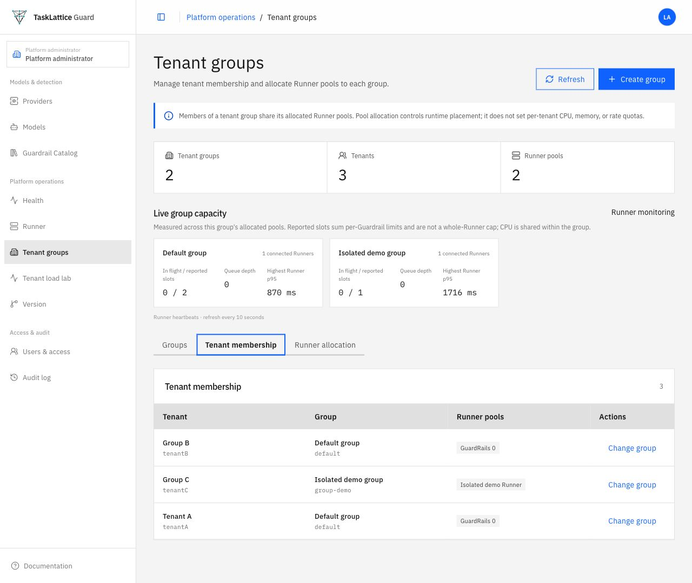
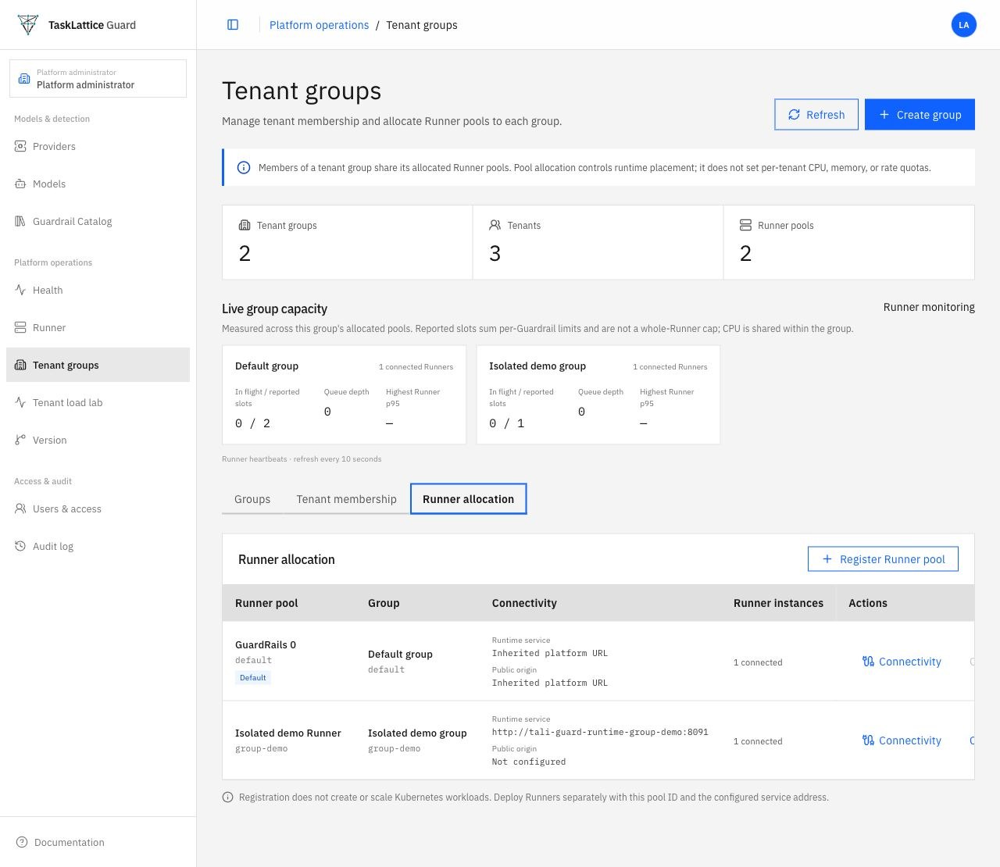
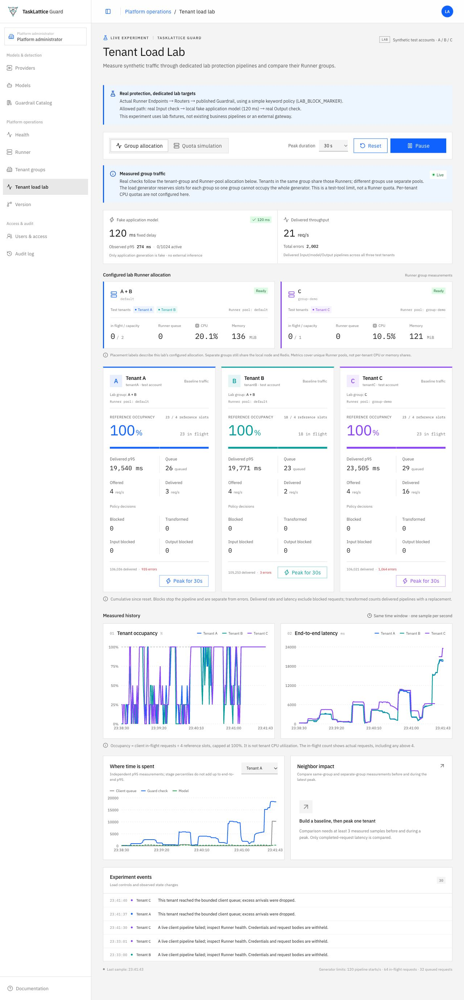

# Multi-tenancy fact check and demonstration

**Audit time:** 28 October 2026, approximately 23:40–23:50 Asia/Shanghai.
**System:** local `guard-tenants` kind cluster, namespace `tali`; working tree based on `6044b72`, with uncommitted tenant-group and lab changes. Controller image `dev-real-pipeline`; Runner image `dev-tenant-groups`. This is a local demonstration, not a production security certification or an exhaustive penetration test. **Historical snapshot:** these findings describe the 28–29 October audited implementation; subsequent uncommitted changes may differ. See [implementation progress](multi-tenancy-implementation-progress.md) for current status.

## Result

**Tenant isolation is implemented for several application resources and ordinary Runner traffic, but it is not applied to every running resource. The current design does not provide a hostile-Runner security boundary or dedicated tenant infrastructure.** The conditional commit/push gate is not met: a shared Runner control credential can claim another registered pool, and shared-Guardrail Playground-shaped events can be attributed to the wrong tenant in isolated reproductions below; several infrastructure and failure scenarios remain shared or unverified.

The evidence in this document is deliberately classified as **live observation**, **automated isolated test**, **code inspection**, or **not verified**. A screenshot records what the console showed at one point in time; it cannot establish authorization or security by itself. Synthetic tenant accounts A, B, and C are test identities, and the lab uses a small keyword policy. No real endpoint credentials, tokens, or private configuration are included in this document.

## Demonstration: tenant groups and real Runner requests



The screenshot shows three tenant IDs: `tenantA` and `tenantB` belong to `default`; `tenantC` belongs to `group-demo`. The display names shown in the console are labels, not tenant IDs. Each group had one connected Runner. The capacity figures are per-Guardrail reported slots; they are not a reservation of CPU, memory, or an entire Runner.



The pool-to-group mapping is visible separately. Runner registration does not itself create or scale a Kubernetes workload.

**Live verification, 28 October:** using the retained synthetic tenant endpoint credentials, all three assigned-pool Endpoint verification requests returned **200**; the same three credentials against the other group's Runner returned **401**. A/B ran on `tali-guard-runner-0`, C on `tali-guard-runner-group-demo-0`. Six benign Input/Output checks returned allowed on their assigned pools. These are real Runtime HTTP checks and create normal synthetic runtime events; they do not demonstrate resistance to a compromised Runner.

**Earlier live policy verification, 28 October:** for each configured lab Endpoint, a benign Input and Output shared a call ID, used its bound Router and published lab Guardrail, and returned `NONE`; a synthetic `LAB_BLOCK_MARKER` Input returned `BLOCKED`. The lab implements a non-streaming gateway flow: real input guard → local fake application model → real output guard. It does not test a separate business gateway, streaming, or a model-based detector. See [lab guide](tenant-load-lab.md) and [gateway contract](gateway-integration.md).



This image captures the existing long-running local experiment, not a controlled new benchmark. Its counters had accumulated more than 100,000 delivered pipelines per tenant and errors; the short displayed latency and queue snapshots coincided with audit database tests on the same one-CPU node. They cannot identify a cause or prove isolation. The lab was **paused after this capture**, without resetting its recorded history, to avoid the continuing test traffic interfering with verification. The displayed per-tenant occupancy is in-flight client pipelines divided by four reference slots, capped at 100%; it is not tenant CPU. The generator reserves slots between groups, and its optional per-tenant quota mode is a client simulation, not a production Runner quota.

## Resource inventory and findings

| Resource | Actual boundary / permission | Evidence and limit |
| --- | --- | --- |
| Policies, policy versions, validation runs and imported definitions | Tenant-owned roots. Reads require ownership or an explicit matching share where supported; writes require the owner. Children resolve through their parent. | PostgreSQL tenant-isolation and sharing suites passed; live C Policy was 404 to A/B while C read it. Not every policy operation was live-tested. |
| Guardrails, versions, packages, artifacts, tests and validation | Tenant-owned root; authorized share permits read and supported composition, not ownership or general mutation. | PostgreSQL isolation suite and live shared C Guardrail read: A/B/C 200. That share did not grant A/B access to C's underlying private Policy (404). Artifact packaging and every possible validation path were not separately tested live. |
| Routers, drafts, revisions, routes and targets | Tenant-owned Router; normal tenant reads/writes scoped to ownership or applicable share. Published revisions select Guardrail targets. | Live own Router detail 200, each foreign tenant Router detail 404, including A↔B in the same group. Automated tenant-sharing and group desired-state tests passed. |
| Endpoints, credential hashes and bindings | Tenant-owned Endpoint; owner controls credentials; Endpoint-to-Router ownership checks apply. Group desired state gives each Runner the appropriate Endpoint verifiers. | Live own detail 200, foreign detail 404; assigned-pool key 200 and wrong-pool key 401 for A/B/C. Does not protect verifiers from a compromised Runner using the shared control credential (finding F1). |
| Tenant Model definitions and pricing usage | Tenant-owned Model definitions; some platform Models and Provider metadata are shared. Price/usage queries have tenant-aware handling. | Isolated model-pricing and tenant-isolation tests passed. Per-tenant dedicated model activation, inference services, and budgets were not established. Provider behavior for every external backend was not live-tested. |
| Users, sessions and personal access tokens | Account identity supplies tenant context; roles and token scopes constrain operations. Platform administration is a separate authority. | Live synthetic identities resolved correctly; spoofed tenant/role headers and query parameters did not expose other lab Endpoints. Token scope and role suites passed; external identity-provider integration was not tested. |
| Shares and grants | Explicit owner-bound grants allow supported recipient reads/composition; group membership alone is not a resource share. | Live shared Guardrail/private Policy checks; isolated share/revocation tests. Revocation under every concurrent production workflow was not tested. |
| Runtime events, route assignments, audit and usage records | Tenant attribution and query scoping exist at the application layer. Shared-Guardrail ownership and invoking tenant are distinct. | External Endpoint-shaped event attribution and several isolated telemetry, pricing and cleanup tests passed. A Playground-shaped event for a shared Guardrail was attributed to its owner, not the invoking tenant, in an isolated real-ingestion reproduction: **F2**. An event with no resolvable resource falls back to tenantA. End-to-end live Playground exposure was not tested. |
| Runner pools, instances, registration and placement | Pools are assigned to groups. Tenant users can see their group's pool; platform admins control pools and membership. Separate processes receive filtered desired state in normal operation. | Live A/B saw only `default`, C only `group-demo`; tenant users received 403 for group administration and Runner pool write attempt. Desired-state tests passed. Shared control credential permits pool impersonation: **F1**. |
| Runner admission, queues and memory | Runtime has admission per Guardrail/version; processes have Kubernetes limits. A/B share a process; C has another. | No per-tenant CPU, memory, throughput or spend reservation was demonstrated; CPU and node are shared even across groups. Lab-only limits do not implement production quotas. |
| PostgreSQL, PVC and schema | One PostgreSQL service and common database tables; isolation relies on Controller predicates rather than database row-level security. | Live cluster inventory and code inspection. PostgreSQL integration tests use separate temporary schemas and verify selected application predicates; they do not prove database-level tenant isolation. |
| Redis and call context | One shared Redis service, with application-scoped context/pins. | Shared infrastructure by deployment; no demonstrated containment against a compromised Runner or Redis access. |
| Controller, global state, outbox, telemetry watermarks, built-in profiles and internal control | One shared Controller and control channel; trusted internal work may bypass tenant predicate when no tenant context is present. | Code inspection and runtime inventory. Fault containment, independent availability and defense in depth are not established. |
| Providers, provider credentials, platform pricing catalogue and model configuration | Platform-managed Providers and global active model configuration; tenant-owned Model definitions are not separate Provider infrastructure. | Code inspection. Credential access is restricted to platform/Runner mechanisms, but active configuration is distributed globally. No per-group credential boundary was proven. |
| Node, Kubernetes network and storage | Both Runner Pods run on one kind node; services and supporting workloads are shared. | Node reports one allocatable CPU and about 1.93 GiB memory. No per-group node or network security boundary was verified; presence of some NetworkPolicies does not prove enforcement. |
| System status, health and metrics | `/api/v1/system/status` and health are public by design; metrics authentication is configuration-dependent. | Live unauthenticated Controller status returned 200; `/metrics` returned 401 in this deployment. This is not a claim that every deployment configures a metrics token. |
| Test generator and fake model | One shared lab Deployment with a fixed-delay fake application model. | Admin-only Controller proxy; generator group reservation and quota simulation affect the experiment itself. The lab is not evidence of production tenant quotas. |

Root ownership and matching-current-owner grants are implemented in [tenant-context.ts](../controller/server/services/tenant-context.ts); the database inventory is in [schema.ts](../controller/server/db/schema.ts). Runner group distribution is implemented in [control-plane.ts](../controller/server/services/control-plane.ts) and [tenant-group-routing.ts](../controller/server/services/tenant-group-routing.ts).

## Findings that prevent an all-isolated claim

### F1 — Shared Runner credential permits pool impersonation (reproduced in isolation)

The control server compares the presented bearer against one configured Runner token, then accepts the Runner's claimed registered pool ID. The Helm Runner configuration shares that credential. Pool-specific desired state follows the claimed pool. A holder of the shared token can therefore claim a different existing pool and receive that pool's distributed state. This is a security limitation for any threat model containing a compromised or malicious Runner; group placement is an operational isolation mechanism under the assumption that Runners and their common credential are trusted.

The [portable diagnostic](../controller/scripts/audit-runner-pool-identity.mjs) invokes the real stream authentication, registration and reconciliation logic with **synthetic** credentials and two in-memory pool/state stubs. The same synthetic bearer claimed both pools and received the second pool's synthetic Endpoint verifier. It did not contact the live cluster or use real credentials. Exposure of actual other-group desired state is an inference from the production desired-state code, not a claim that a real secret was stolen.

```bash
cd controller
node --import tsx scripts/audit-runner-pool-identity.mjs
```

See [control-server authentication](../controller/server/control-channel/control-server.ts), [registration and pool desired state](../controller/server/services/control-plane.ts), and [Runner deployment](../charts/tali-guard/templates/runner-statefulset.yaml). A robust security boundary needs an authenticated workload identity or credential bound to the authorized pool, and tests for both registration and access to group-specific state and credentials.

### F2 — Shared-Guardrail Playground event attribution (reproduced in an isolated database)

The [isolated diagnostic](../controller/scripts/audit-tenant-attribution.postgres.test.ts) used a C-owned Guardrail explicitly shared to A and verified that A could read it. It then passed a Playground-shaped event through the real `ControlPlaneService.recordRuntimeEvents` ingestion path with C's Guardrail ID but no Endpoint or Router ID. Both the runtime event and model usage cost were stored as tenantC. An Endpoint-shaped control event was stored as tenantA, while an unknown Guardrail ID fell back to tenantA. No live records were touched; the UUID-scoped schema was dropped.

The diagnostic was rerun on 29 October and reproduced the same result before subsequent implementation work. The linked script has since been changed to assert the desired corrected behavior, so its current result is a regression check, not a reproduction of the original finding. See the progress log for its validation status. It uses a private test database URL and temporary schema. The diagnostic is skipped if `GUARD_TEST_POSTGRES_URL` is absent; a skipped run is not a reproduction. From `controller/`, set `GUARD_TEST_POSTGRES_URL` privately, then run `npx vitest run scripts/audit-tenant-attribution.postgres.test.ts --environment node --maxWorkers=1 --hookTimeout=30000`.

The relevant inference is that A's published Playground request can produce that event shape: the Controller sends the selected Guardrail and message to the Runner, the Runner's internal Guardrail evaluation has no Endpoint ID, and ingestion derives the tenant from Endpoint, Router, then Guardrail ownership, then a tenantA fallback. Thus the isolated reproduction demonstrates the attribution defect; an end-to-end live Playground test and actual disclosure of sensitive content were not demonstrated. Depending on enabled telemetry capture, the wrong tenant may see operational evidence or costs. See [tenant-context.ts](../controller/server/services/tenant-context.ts), [runtime-event-write.ts](../controller/server/services/runtime-event-write.ts), [model-pricing.ts](../controller/server/services/model-pricing.ts), and [Runner internal evaluation](../runner/api.py).

### F3 — Reassignment under silent network partitions is unverified

Reassignment waits for old Runner registrations to become offline; Runner request fencing reacts to a **detected** control-stream disconnect. The five focused fencing tests passed for that behavior. A silent or one-way network partition could have different timing from a detected disconnect; no lease-expiry/fault-injection demonstration was completed in this audit. Treat this as a risk inferred from code, not a confirmed live exploit. See [tenant-groups.ts](../controller/server/services/tenant-groups.ts), [control_client.py](../runner/control_client.py), and [synchronization.py](../runner/synchronization.py).

### F4 — Shared physical and platform resources

Groups share a node, Controller, PostgreSQL, Redis and platform model/provider configuration. Separate Runner processes therefore do not guarantee independent CPU, memory, network, persistence, availability or cost quotas. These are design boundaries and unimplemented guarantees, not failed endpoint-authorization tests.

## Reproducible verification record

1. **Live permissions:** a read-only audit of the three retained synthetic accounts verified six own Endpoint/Router details as 200 and twelve foreign details as 404; three spoofed-tenant list checks; group-filtered pool lists; and three 403 responses each for tenant group administration and Runner-pool write attempts. The invalid-body PATCH checks that role middleware denies the request before mutation; it is not a test of a successful administrative write. The [local audit script](../scripts/audit-tenant-http.mjs) requires the ignored private identities and lab fixtures and logs status only. Session creation produces normal authentication records.
2. **Live shares:** six read checks verified C's explicitly shared Guardrail was visible to A/B/C and C's unshared Policy was visible only to C. No share was created or revoked in this live check.
3. **Live Runner boundaries:** three allowed correct-pool verifications, three wrong-pool 401s, and six allowed Input/Output calls, as described above. Tenant A/B are distinct owners despite sharing a pool.
4. **PostgreSQL integration:** 47/47 tests passed across nine isolated-schema suites: tenant and group migrations; multi-tenant HTTP; tenant isolation; tenant groups; group routing; access tokens; model pricing; and operational-data cleanup. Each suite uses disposable UUID-scoped schemas. The old migration test was corrected to run migrations after seeding legacy rows in journal order; the mock-SSO test fixture was corrected to seed the default pool expected by normal bootstrapping. These are test-fixture edits, not production fixes.
5. **In-process Controller suites:** 420/420 tests across eleven focused RBAC, authorization, sharing, personal-token, Runner management, group routing, desired-state, control-channel and lab suites passed. These test mock or in-process boundaries, not every deployed endpoint.
6. **Additional PostgreSQL integration:** 90/90 tests passed across model configuration, traffic routing, runtime-event writes, security-event pagination, and Router/Endpoint migration. Provider calls were simulated; the security pagination suite used a session-local temporary table. These tests do not cover the Playground attribution defect above. An additional one-test isolated diagnostic deliberately reproduced that defect and must not be counted as a successful isolation test.
7. **Runner:** five synchronization/fencing tests passed for detected disconnects. The separate isolated shared-token diagnostic reproduced F1. A separate 21-test focused control-channel/group-routing run also passed; its tests overlap the broader Controller run and are not additional unique coverage.
8. **Build and contract:** see the final recorded checks below. A passing build or OpenAPI contract does not establish tenant isolation.

The live lab currently contains a synthetic A/B/C configuration and must remain private. Never copy ignored files under `.local-secrets/`, endpoint credentials, bearer tokens, session cookies, or raw private test state into a screenshot, report, commit, or issue. Local URLs and Kubernetes names in these screenshots describe this particular demo only.

The 47-test PostgreSQL run used `--maxWorkers=1` and `--hookTimeout=30000` against the local test database named by `GUARD_TEST_POSTGRES_URL`; it ran these files from `controller/`:

```text
server/db/multi-tenant-migration.postgres.test.ts
server/db/tenant-group-migration.postgres.test.ts
server/http/multi-tenant.postgres.test.ts
server/services/tenant-isolation.postgres.test.ts
server/services/tenant-groups.postgres.test.ts
server/services/tenant-group-routing.postgres.test.ts
server/services/access-tokens.postgres.test.ts
server/services/model-pricing.postgres.test.ts
server/services/guardrail-operational-data.postgres.test.ts
```

For an equivalent configured test database, set `GUARD_TEST_POSTGRES_URL` privately and use `npx vitest run <the files above> --environment node --maxWorkers=1 --hookTimeout=30000`. Do not print the URL. PostgreSQL tests need schema create/drop permissions, and their UUID schemas are disposable.

The 420-test in-process run used:

```bash
cd controller
npx vitest run \
  server/http/product-authorization.test.ts server/http/tenant-sharing.test.ts \
  server/http/tenant-groups.test.ts server/http/tenant-group-routing.test.ts \
  server/http/access-tokens.test.ts server/http/runner-management.test.ts \
  server/http/tenant-load-lab.test.ts server/services/tenant-context.test.ts \
  server/services/control-plane-desired-state.test.ts \
  server/control-channel/control-server.test.ts shared/rbac.test.ts \
  --environment node --maxWorkers=1
```

`npm run typecheck`, `npm run build`, and `npm run openapi:check` passed in `controller/` after the fixture changes; the contract check reported 152 operations and 457 schemas. Existing Sass and bundle-size warnings appeared in the UI build. `git diff --check` is run again when the report is complete.

The 90-test additional PostgreSQL run set both `GUARD_TEST_POSTGRES_URL` and `TEST_DATABASE_URL` privately, then ran:

```bash
cd controller
npx vitest run server/model-config/model-configuration.postgres.test.ts \
  server/services/traffic-routing.postgres.test.ts \
  server/services/runtime-event-write.postgres.test.ts \
  server/services/security-events.postgres.test.ts \
  server/db/router-endpoint-migration.postgres.test.ts \
  --environment node --maxWorkers=1 --hookTimeout=30000
```

The sanitized [live HTTP status transcript](evidence/multi-tenancy-2026-10-28/live-http-authorization.txt) records only synthetic tenant names and response statuses.
