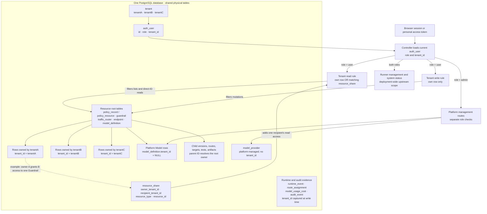

# Multi-tenant storage and isolation

Drawn from the `feat/multi-tenant-v2` implementation at `6044b72` (2026-10-22).

The Controller stores all tenants in **one PostgreSQL database**. Tenant boundaries are row-level ownership and server-side authorization rules; the boxes for tenantA, tenantB, and tenantC below are logical row groups within the same tables, not separate schemas or databases.

For a tenant user, a resource read succeeds when its root `tenant_id` matches the authenticated user's tenant, or when `resource_share` contains a grant matching the **current owner**, recipient tenant, resource type, and resource ID. For example, when tenantA shares a Guardrail with tenantB, the Guardrail remains a tenantA row; the grant lets tenantB read and use it without copying it into tenantB's rows. A grant does not permit edits, publication, deletion, credential access, or onward sharing. Writes require ownership. Child records inherit the boundary through their parent root even when they have no `tenant_id` column of their own.

The root tables group tenant rows by `tenant_id`: Policies, Guardrails, Routers, and Endpoints have a non-null owner; `model_definition.tenant_id` is nullable, with `NULL` denoting a platform Model. `model_provider` has no tenant owner and is managed by the internal platform. Tenant users may select available Provider metadata but cannot manage Providers or view their credentials. Platform administrators use separate role-checked routes; their `auth_user.tenant_id` value does not make them a tenant author.

Runtime events, route assignments, model usage costs, and audit events keep tenant attribution on their own rows so later resource changes do not reassign historical evidence. Queries apply the tenant boundary before returning lists and aggregates where those APIs expose tenant evidence. Runner management and system status retain upstream's deployment-wide scope for both account roles. The [migration](../controller/server/db/migrations/0049_multi_tenant_resources.sql), [schema](../controller/server/db/schema.ts), and [tenant context rules](../controller/server/services/tenant-context.ts) are the source of truth for the exact columns and predicates.
