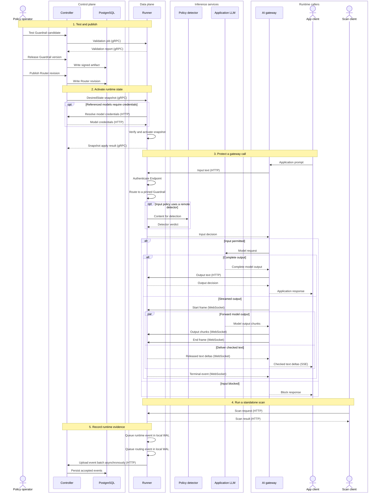
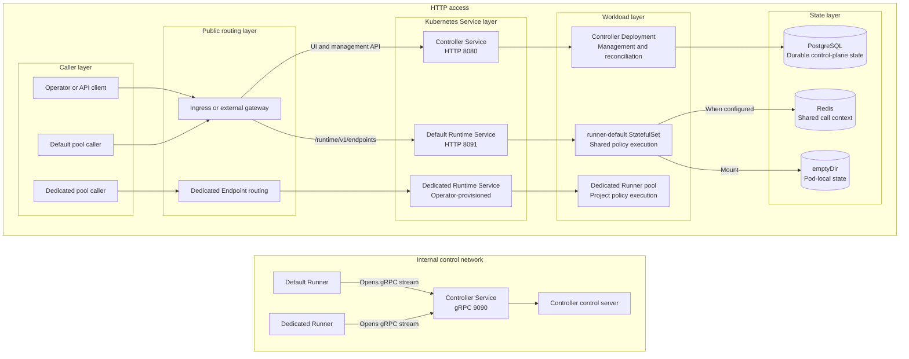

# TaskLattice Guard data flow and infrastructure

TaskLattice Guard has two application components. The **Controller** is the TypeScript control plane. It serves the React console and Hono management API, manages Projects and policy releases, and reconciles Runner configuration. The **Runner** is the Python data plane. Its FastAPI endpoints evaluate traffic using locally activated NVIDIA NeMo Guardrails artifacts. The topology below describes the repository’s Helm configuration.

## 1. Data flow

1. **Test and publish.** An operator composes versioned Policies into a Guardrail, tests the candidate on a compiler-capable Runner, and releases the version. The Controller verifies and signs the artifact and records it in PostgreSQL. Publishing a Router revision pins its targets to specific Guardrail versions.
2. **Activate runtime state.** The Controller sends one `DesiredState` snapshot per generation to each targeted pool. It contains the pool’s Endpoint settings, Router revisions, artifacts, and model configuration. Runners fetch model credentials over authenticated HTTP, verify the artifacts, and prewarm versions targeted by enabled Routes with positive weight. They activate the snapshot atomically and report the result over gRPC. Other verified versions load on demand.
3. **Protect a gateway call.** The Runner applies the Endpoint’s access settings and configured admission limits. The first matching Route selects a Guardrail version by deterministic weighted assignment. The call ID carries that selection from input to output through short-lived Runner context. NeMo can call configured detectors during either check. The gateway owns the model request and client response, including forwarding checked deltas for streaming calls.
4. **Run a standalone scan.** A Scan client submits a request directly to its Project’s Runner Endpoint. Each scan gets its own evaluation and result.
5. **Record runtime evidence.** The Runner queues runtime and routing events in its local write-ahead log and uploads them to the Controller in batches for persistence in PostgreSQL.

Playground requests use a separate path in which the Controller orchestrates checks over the Runner’s internal HTTP API.

Sources in the repository include the [gateway contract](gateway-integration.md), [Runner HTTP adapters](../runner/api.py), [routing and assignment](../runner/routing.py), [Controller publication service](../controller/server/services/control-plane.ts), and [gRPC contract](../proto/tasklattice/guard/control/v1/runner_control.proto).

## 2. Infrastructure

- **Exposure and placement.** The chart’s internal Services default to `ClusterIP`. With a shared public hostname, the runtime Endpoint prefix goes to the Runtime Service and the remaining paths go to the Controller’s HTTP port. A dedicated Project pool is registered through the Controller and provisioned separately with its own Runtime Service and reachable Endpoint origin. Projects in the default runtime group without a dedicated allocation share `runner-default`. If a dedicated pool goes offline, its Project loses runtime capacity. The Runner’s headless Service gives default pool Pods stable DNS names.
- **State and credentials.** PostgreSQL is the Controller’s durable store and is typically supplied externally. The Helm bootstrap Job initializes internal credentials when their Secrets are managed by the chart. The control stream uses token authentication and enables mTLS by default. Runners keep artifacts and unsent telemetry in `emptyDir`, which survives a container restart within a Pod and is discarded when that Pod is replaced. Redis, when configured, lets replicas share short-lived call context. A single Runner can use memory for call context.
- **Availability.** The Runtime Service balances traffic across ready replicas without session affinity. The base chart starts one Controller and one default Runner. Scaling the default pool above one replica requires Redis. Runner readiness requires synchronization with the Controller and prewarmed versions for active Route targets. A control-stream disconnect makes the Runner unready until it synchronizes again.
- **Development and monitoring.** The local UAT values enable in-cluster PostgreSQL and Redis and expose Controller HTTP and Runtime on ports `38081` and `38082`. Embedded Keycloak and a LiteLLM test gateway are optional. The chart can integrate with Prometheus and Grafana, and traces and profiling can be enabled separately.

Sources in the repository include the [Helm values](../charts/tali-guard/values.yaml), [Service definitions](../charts/tali-guard/templates/service.yaml), [Runner StatefulSet](../charts/tali-guard/templates/runner-statefulset.yaml), [local UAT values](../charts/tali-guard/values-dev-uat.yaml), and [Runner readiness handler](../runner/main.py).
