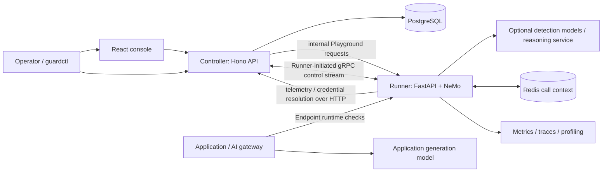

# TaskLattice Guard: a detailed project walkthrough

This guide explains the repository from product concepts to executable code. It was prepared on **2026-10-24** against the current working tree. Code excerpts are deliberately short; follow the adjacent source links for complete functions and error paths. It complements the [architecture reference](architecture.md), [development guide](development.md), and [runtime integration guide](gateway-integration.md).

The guide describes implemented behavior. Design proposals and historical evaluation reports elsewhere in `docs/` can describe earlier or future states. No application source was changed to prepare this guide. The example test result mentioned in section 28 is historical evidence from **2026-10-22**, not a new test run on the preparation date. Current isolation findings and local verification are recorded separately in the [2026-10-24 isolation audit](multi-tenancy-isolation-audit-2026-10-24.md) and [local testing report](multi-tenancy-local-testing-2026-10-24.md).

## 1. What the product does

TaskLattice Guard checks text crossing an AI application's input and output boundaries. An application or AI gateway submits content, receives a protection decision, and applies that decision before calling a model or delivering its response. Checks include sensitive data, credentials, prompt injection, harmful content, topic restrictions, grounding, and optional formal reasoning.

There are two distinct model roles: the application's **generation model** produces its answer; configured **detection models** help Guard evaluate content. Many local policies need no detection model. Playground can orchestrate a generation model for testing, but the production check API does not become the application's generation gateway.

```text
User input → gateway → Guard input check → apply decision → generation model
User output ← gateway ← Guard output check ← model response
```

The gateway owns model invocation, mapping replacements into its payload, downstream delivery, and upstream cancellation. Guard returns actions or approved stream text. It cannot retract content already delivered by the gateway. See [README](../README.md) and [gateway responsibilities](gateway-integration.md).

## 2. The architecture: Controller and Runner

The **Controller** owns configuration, identity, persistence, testing orchestration, publication, and operational views. The **Runner** authenticates runtime endpoints, resolves routing, loads verified artifacts, executes NeMo Guardrails, and exports evidence. PostgreSQL, Redis, and observability backends support those components.



Ordinary Endpoint checks go directly to Runner. They do not synchronously query PostgreSQL through Controller. A synchronized Runner can continue serving a verified last-known-good release during a temporary Controller outage; new configuration, new credential resolution, and telemetry ingestion still depend on Controller availability.

The mandatory compiler-capable `default` Runner pool is sometimes called **GuardRails 0**. It is a Runner role, not a third application. [Controller boot](../controller/server/index.ts), [Runner boot](../runner/main.py), and [Helm topology](../charts/tali-guard/templates/) show the boundaries.

## 3. The domain hierarchy and its different version identities

```text
Detector → Rule → Policy → Guardrail draft → tested Artifact → released version
                                                             ↑
Endpoint → published Router revision → matching Route → weighted target
```

| Concept | Meaning | Identity/version boundary |
| --- | --- | --- |
| Detector | A technical matching mechanism | Detector reference and version |
| Rule | Stage, detector parameters, risk, and requested action | Stable Rule ID within a Policy |
| Policy | Ordered Rules or programmable NeMo flows, parameters, resources, tests | Policy ID plus exact Policy version |
| Guardrail | Ordered Policy bindings and product settings | Guardrail ID and mutable draft revision |
| Artifact | Frozen executable plan, NeMo config/Colang, prompts, action bindings, dependencies | Content checksum and environment signature |
| Guardrail version | Immutable published or imported protection content | Guardrail ID plus version string |
| Router revision | Ordered selectors and weighted fixed-version targets | Router ID plus revision number |
| Endpoint | Integration adapter, credential verifiers, explicit Router binding | Endpoint UUID |
| Desired generation | Controller distribution snapshot | Monotonic deployment generation |
| Effective release | Runtime materialization of artifacts and model configuration | Runtime release ID |

These identifiers answer different questions. Publishing a new Guardrail version does not silently rewrite targets in an existing Router revision. A desired generation is not a Policy version. An environment signature can change while promoted content retains its checksum. Contracts live in [Protobuf files](../proto/tasklattice/guard/control/v1/) and [shared TypeScript types](../controller/shared/).

## 4. Repository map

| Directory/file | Purpose |
| --- | --- |
| [`controller/src/`](../controller/src/) | React routes, domain UI, API adapters, localization, CLI |
| [`controller/server/`](../controller/server/) | Hono management API, services, auth, gRPC server, persistence |
| [`controller/shared/`](../controller/shared/) | Shared validation and domain contracts used by server and browser |
| [`runner/`](../runner/) | FastAPI host, control client, artifact store, adapters, telemetry |
| [`runner/toolkit/compiler/`](../runner/toolkit/compiler/) | Offline frozen-plan-to-NeMo compiler |
| [`runner/toolkit/nemo/`](../runner/toolkit/nemo/) | NeMo registry/runtime, actions, evaluator adapters, output execution |
| [`runner/toolkit/runtime/`](../runner/toolkit/runtime/) | Engine contracts, content views, routing/execution service, modes |
| [`runner/toolkit/policy_runtime/`](../runner/toolkit/policy_runtime/) | Local detectors, conditions, pattern validation, policy execution |
| [`policies/`](../policies/) | Human-maintained Policy packages, Rule YAML, tests, schemas |
| [`proto/`](../proto/) | Authoritative Controller/Runner message contracts |
| [`charts/`](../charts/) | Product Helm chart and separate LiteLLM integration test chart |
| [`scripts/`](../scripts/) | Build, deployment, contract generation, policy tooling, evaluations |
| [`tests/`](../tests/) | Python control-plane, data-plane, contract, and communication tests |
| [`docs/`](./) | User/architecture docs, design proposals, evaluation evidence |
| [`package.json`](../package.json), [`pyproject.toml`](../pyproject.toml) | Command entry points and Node/Python dependencies |

Generated protocol bindings and generated policy catalogs are outputs of project scripts. Their presence in source control does not make them the preferred editing surface.

## 5. Controller startup, step by step

[`controller/server/index.ts`](../controller/server/index.ts) is the composition root:

1. Load environment configuration and connect to PostgreSQL.
2. Run Drizzle migrations.
3. Create `ControlPlaneService`, reseal artifacts when the digest contract changed, initialize platform/default resources, and start pricing work.
4. Prune retained testing reports and initialize model configuration.
5. Create Better Auth; create missing configured bootstrap accounts and optional mock SSO identities.
6. Start `RunnerControlServer` on the internal control port.
7. Construct optional intent-analysis and Playground clients.
8. Build the Hono app with these dependencies and start HTTP serving.
9. On SIGTERM/SIGINT, stop pricing/control work, close HTTP, and close the DB pool.

The actual initialization order begins:

```ts
const config = loadConfig();
const { db, pool } = createDatabase(config);
await runMigrations(config, db);
const service = new ControlPlaneService(db, config);
const resealed = await service.resealArtifacts();
```

The large [`ControlPlaneService`](../controller/server/services/control-plane.ts) coordinates Guardrail lifecycle and runner state; specialized services handle routing, models, policies, packages, logs, audit, pricing, and tenancy. [`http/app.ts`](../controller/server/http/app.ts) exposes management and internal APIs; it is the HTTP boundary, rather than the location of every business rule.

## 6. Console, session state, and API client

The browser starts in [`controller/src/main.tsx`](../controller/src/main.tsx), then renders the route tree in [`app-router.tsx`](../controller/src/app-router.tsx). It uses React, TanStack Router/Query, i18next, Carbon controls, and reusable domain components. The console targets desktop browsers; [development guidance](development.md) defines its design and interaction contracts.

```tsx
const queryClient = new QueryClient({ defaultOptions: { queries: { staleTime: 10_000, retry: 1 } } });
startPageUpdates({ isBusy: () => queryClient.isMutating() > 0 });
```

Routes cover Guardrails, Policy Library, Playground, Routers, Endpoints, logs, costs, audit/access, account tokens, providers/models, health, runner fleet, build versions, and embedded documentation. [`routes/layout.tsx`](../controller/src/routes/layout.tsx) selects login or the role-aware shell and guards page visibility.

The usual call chain is `route → query/mutation → domain API adapter → requestController → /api/v1/...`. [`lib/guardrails-api.ts`](../controller/src/lib/guardrails-api.ts) also maps Controller camelCase data into UI models. The HTTP transport in [`lib/controller-api.ts`](../controller/src/lib/controller-api.ts) includes same-origin cookies:

```ts
const response = await fetch(path, {
  credentials: "same-origin",
  ...init,
```

GET requests have bounded abort timeouts; errors retain HTTP status/code/detail; 401/403 trigger identity refresh. [`lib/auth.tsx`](../controller/src/lib/auth.tsx) clears authority-scoped resource caches when identity, role, tenant, or enabled state changes. React page permissions supplement server enforcement.

## 7. A concrete Policy package

[`policies/examples/customer-information/`](../policies/examples/customer-information/) is a compact working example. Its manifest names Rules in execution order, declares tests, and requires complete output:

```yaml
  output_delivery: full_buffered
execution:
  mode: sequential
  input: previous_output
  stop_on: block
rules:
- rules/customer-id.yaml
- rules/internal-secret.yaml
tests:
- tests/acceptance.yaml
- tests/regression.yaml
```

The first Rule, [`rules/customer-id.yaml`](../policies/examples/customer-information/rules/customer-id.yaml), detects and replaces a customer identifier:

```yaml
id: customer-id
name: 遮盖客户编号
stages:
- output
detector:
  ref: text/regex
  version: 1.0.0
  parameters:
    expression: \bCUS-\d{6}\b
risk_level: medium
on_match:
  action: transform
  replacement: '[客户编号已隐藏]'
```

The next Rule detects `INTERNAL_SECRET` and requests `block`. Package-local resources can hold data and fixtures; the package loader checks declarations, hashes, path containment, and resource limits. [`policies/README.md`](../policies/README.md) explains authoring, regression, import, and export. [`scripts/policy_sources.py`](../scripts/policy_sources.py) builds/checks catalog outputs; runtime traffic does not parse source YAML.

## 8. Detector results, Rule handling, and execution order

A detector answers whether its declared condition was found. A Rule supplies the risk classification and handling. These are separate axes: a high-risk match may be recorded without blocking; a transform need not imply low risk; an error is not evidence of a match.

The shared evaluator vocabulary in [`runtime/contracts.py`](../runner/toolkit/runtime/contracts.py) is:

```python
EvaluatorVerdict = Literal["matched", "not_matched", "unknown", "error"]
```

`matched` means the target condition was found; `not_matched` means it was not found; `unknown` is valid but inconclusive evidence; `error` means the check could not execute correctly. Provider-native labels are normalized at the evaluator boundary. Failure/escalation policies resolve inconclusive or failed checks.

[`policy_runtime/detectors.py`](../runner/toolkit/policy_runtime/detectors.py) explicitly separates detection from business handling:

```python
"""Business-independent local detectors. No actions, risk levels or Policy IDs."""
```

The local registry covers keyword, regex, compositional conditions, and fenced-code mechanisms. Candidate validators add checks such as Luhn, dates, and weighted checksums. Model/formal contracts use their dedicated adapters. Rules execute in configured order; replacements become the next Rule's input; a blocking result stops that execution path. Binding overrides can change selected Rules, order, actions, and parameters, while source risk severity remains pinned.

## 9. Turning an editable draft into a frozen plan

[`domain/guardrail-plan.ts`](../controller/server/domain/guardrail-plan.ts) translates product configuration into executable intent. The draft selects exact Policy versions, enabled Rule IDs, order, action overrides, parameter values, and Rails:

```ts
export type GuardrailDraftConfig = {
  allowedTopics: string[];
  topicControlMode?: "strict" | "permissive";
  restrictedTopics: string[];
  policyBindings: GuardrailPolicyBindingConfig[];
  safetyLevel: "balanced" | "strict";
  outputDelivery: "interruptible" | "window_buffered" | "full_buffered";
};
```

Plan construction resolves materialized Rules, frozen local Policy definitions, programmable Policy source snapshots, evaluation contracts, module behavior, and dependencies. [`policy-node.ts`](../controller/server/domain/policy-node.ts), [`policy-rules.ts`](../controller/server/domain/policy-rules.ts), and [`policy-parameters.ts`](../controller/shared/policy-parameters.ts) support that translation.

The important property is self-containment: a Policy ID alone is insufficient executable content. A later Library edit cannot change the definitions embedded in an already compiled artifact. Missing definitions or incompatible dependencies are errors rather than invitations to fall back to a mutable catalog.

## 10. Validation compiles and executes the real candidate

Draft validation is not merely JSON schema validation. Controller freezes the request plan and reviewed test suite, persists a run/outbox task, and dispatches it to a compiler-capable Runner. [`runner/validator.py`](../runner/validator.py) prepares a private runtime and runs cases through the actual NeMo boundary.

```python
@dataclass(frozen=True)
class ValidationOutcome:
    """Test evidence plus the exact Artifact content the cases ran against."""

    status: str
    metrics: dict[str, Any]
    results: list[dict[str, Any]]
    artifact: protocol.Artifact
```

[`DefaultRunnerCompiler`](../runner/compiler.py) snapshots active target capabilities and delegates to [`ArtifactCompiler`](../runner/toolkit/compiler/artifact.py). The offline compiler itself requires no Controller connection, credentials, or mutable Policy catalog:

```python
class ArtifactCompiler:
    """No Runner configuration, credentials, Controller connection or Policy catalog."""
```

Its artifact includes the plan, generated YAML/Colang, prompts, Action bindings, dependency manifest, compiler version, and NeMo version. Validation progress/results return over control messages. Controller checks that the returned artifact matches the requested identity, plan, and profile before accepting its evidence. Local-only test projections record skipped model Rules; they do not establish that unexecuted model checks passed.

The UI polls queued/running reports every second with a bounded wait in [`guardrails-api.ts`](../controller/src/lib/guardrails-api.ts). A timeout waiting for the UI report is not proof that the server job stopped.

## 11. Publishing signs exactly what passed

[`requestGuardrailPublish`](../controller/server/services/control-plane.ts) locks the Guardrail, checks `expectedDraftRevision`, rechecks current Policy access, and requires a passing run for that current revision. [`publishValidatedCandidate`](../controller/server/services/control-plane.ts) publishes its frozen content without recompiling from the draft or Library.

```ts
const content = artifactContent(candidate);
const checksum = artifactContentDigest(content);
if (checksum !== run.candidateDigest) throw new ConflictError("The stored test candidate no longer matches its digest.", "guardrail_candidate_corrupt");
```

The transaction stores the immutable version, source/inspection/Policy/test snapshots, artifact, release evidence, audit event, and desired-state outbox event. It increments desired generation. The ordinary locally validated publication is released immediately; repeating publication of the same existing tested version is a no-op.

[`domain/artifact-content.ts`](../controller/server/domain/artifact-content.ts) defines canonical SHA-256 and Ed25519 signing:

```ts
export function artifactContentDigest(value: ArtifactContent): string {
  return createHash("sha256").update(canonicalJson(artifactContent(value))).digest("hex");
}

export function signArtifactDigest(digest: string, privateKeyPath: string): string {
  return sign(null, Buffer.from(digest, "utf8"), createPrivateKey(readFileSync(privateKeyPath))).toString("base64");
}
```

Digest v2 excludes local artifact ID and delivery generation, so promoted content can retain one digest across environments. Signatures protect executable content integrity; they do not prove the detector has perfect accuracy.

## 12. Distribution: durable outbox and bidirectional gRPC

[`runner_control.proto`](../proto/tasklattice/guard/control/v1/runner_control.proto) defines the state-distribution channel:

```proto
service RunnerControl {
  rpc Connect(stream RunnerMessage) returns (stream ControllerMessage);
}
```

Runner initiates the connection, registers stable runner/pool identity plus a unique boot ID and capacities, then sends heartbeats, validation evidence, progress, artifact admission results, and desired-state ACK/NACK results. Controller sends registration acceptance, desired snapshots, validation/capability/admission requests, drain requests, and protection-mode state.

[`control-channel/control-server.ts`](../controller/server/control-channel/control-server.ts) and [`runner/control_client.py`](../runner/control_client.py) implement both sides. DB-backed outbox tasks keep business operations recoverable across process interruptions; registration/boot correlation prevents stale process results from impersonating current state. An ACK describes a Runner's applied state, while a stored desired revision describes Controller intent.

The stream uses token authentication, with mTLS by default in production chart values. Telemetry batches and model-secret resolution use separately authenticated internal HTTP endpoints; Protobuf is not a claim that every intercomponent exchange uses gRPC.

## 13. Runner startup and atomic generation activation

[`runner/main.py`](../runner/main.py) creates artifact storage, Action providers, metrics, a NeMo registry/runtime, context storage, runtime service, telemetry, optional compiler/draft previews, control client, and HTTP adapters. Its lifespan starts control, telemetry, and retirement work and shuts them down together.

```python
contexts = (
    RedisCallContextStore(configured.call_context_redis_url)
    if configured.call_context_redis_url
    else CallContextStore()
)
runtime = GuardrailRuntimeService(engine, store, contexts=contexts)
```

[`ArtifactStore.apply`](../runner/artifact_store.py) stages a full generation rather than replacing fields request by request:

1. Reject an older generation.
2. Verify changed artifacts, checksums/signatures, and NeMo compatibility.
3. Validate Router snapshots, their targets, and Endpoint verifier/binding data.
4. Prepare/prewarm candidate NeMo runtimes and model dependencies.
5. Persist the last-known-good snapshot when configured.
6. Publish registry and store state together through `registry.publish_release(...)`.
7. ACK success, or discard prepared state and NACK failure.

Artifact verification includes:

```python
checksum = hashlib.sha256(canonical_json(content).encode()).hexdigest()
if not hmac.compare_digest(checksum, message.checksum):
    raise ValueError(f"Artifact {message.artifact_id} checksum does not match its content.")
self._public_key.verify(_base64(message.signature), checksum.encode())
```

Fresh Pods stay unready until a successful synchronization; a temporary disconnected Controller does not remove a previously synchronized healthy Runner. Registry retirement allows retained in-flight releases to finish before resources are collected. Chart cache storage is ephemeral, so Pod replacement still needs resynchronization.

## 14. Runtime entry: Endpoint authentication and explicit binding

An Endpoint is an integration identity, not a direct mutable Guardrail pointer. [`runner/api.py`](../runner/api.py) validates adapter requests, authenticates the Endpoint, normalizes request context, invokes runtime service, maps the response, and records telemetry. Scan has a separate adapter in [`runner/scan.py`](../runner/scan.py).

Endpoint secrets are distributed as verifiers. The runtime uses local state:

```python
actual = hashlib.sha256(credential.encode()).hexdigest()
authenticated = False
for expected in expected_digests:
    authenticated = hmac.compare_digest(actual, expected) or authenticated
```

Source: [`ArtifactStore.authenticate_endpoint`](../runner/artifact_store.py). Revoked credentials are excluded. Controller-side creation/rotation is in [`endpoint-credentials.ts`](../controller/server/services/endpoint-credentials.ts); plaintext credentials are not needed for every live check.

After authentication, [`ArtifactStore.resolve`](../runner/artifact_store.py) finds the Endpoint's explicitly bound Router revision, then its selected artifact. An unbound Endpoint fails resolution; it never inherits a default Router implicitly. Authentication, adapter compatibility, routing availability, and protection decisions are different outcomes.

## 15. Route matching, weighted assignment, and publication review

[`runner/routing.py`](../runner/routing.py) evaluates enabled Routes in order. A normal Route has a selector; one enabled unconditional fallback must be last. Expressions support nested AND/OR, fields, endpoint or business HTTP metadata, membership, equality, glob, and existence operations, subject to bounds and source validation.

Each selected Route has integer target weights totaling **10,000 basis points**. Assignment is deterministic for its call identity, Router revision, Route ID, and secret key:

```python
data = json.dumps([context.call_id or assignment["decisionId"], int(router.revision), route.route_id], ensure_ascii=False, separators=(",", ":")).encode()
bucket = int.from_bytes(hmac.digest(router.assignment_key, data, "sha256"), "big") % 10000
for target in route.targets:
    if bucket < target.weight_bps:
        assignment.update(targetId=target.target_id, guardrailId=target.guardrail_id, guardrailVersion=target.guardrail_version, assignmentStatus="assigned")
        return target, assignment
    bucket -= target.weight_bps
```

A 7,000/3,000 split means distribution over many independent assignments; it does not promise exactly seven of every ten calls. Published targets reference exact released versions/artifacts.

[`TrafficRoutingService`](../controller/server/services/traffic-routing.ts) implements draft save with expected revision, publication preview, frozen change submission, approval/rejection/withdrawal, emergency apply, revert, and immutable history. Submission alone does not publish. Approval rechecks staleness/access/dependencies, stores a revision, and advances desired generation. [`traffic-routing-api.ts`](../controller/src/lib/traffic-routing-api.ts) and [`router-detail.tsx`](../controller/src/routes/router-detail.tsx) expose that workflow.

## 16. Pinning input and output to one call

Input and output belonging to one model call must share the same Endpoint and call ID. [`GuardrailRuntimeService._resolve_call`](../runner/toolkit/runtime/service.py) reuses stored resolution, messages, and content context:

```python
if stored is not None:
    if stored.resolution.endpoint_id != request.context.endpoint_id:
        from runner.routing import RoutingError
        raise RoutingError("call_endpoint_mismatch")
    return stored.resolution, stored
```

The context retains the selected Router/Route/target, immutable plan, effective runtime release, and model revision. A Router or model activation between input and output therefore does not automatically reassign an existing valid call.

Redis-backed context in [`runner/call_context.py`](../runner/call_context.py) allows a later request to land on another replica. In-memory [`CallContextStore`](../runner/toolkit/runtime/context.py) suits a single process; it cannot provide shared replica state. The documented default retention is 300 seconds. Expiration, loss, endpoint mismatch, or unavailable pinned releases can fail correlated output; changing the ID creates a different association rather than recovering the old one.

## 17. Where NeMo actually executes

[`NeMoConfigCompiler`](../runner/toolkit/compiler/nemo_compiler.py) selects a supported runtime profile from the frozen plan:

| Profile | Runtime role |
| --- | --- |
| `iorails_native` | Native input/output Rails where the plan supports this profile |
| `llmrails_colang1_standard` | Standard LLMRails/Colang 1 configuration and registered Actions |
| `llmrails_colang2_programmable` | Programmable Policy flow execution requiring Colang 2 |

The runtime snapshot pins YAML, Colang, prompts, bindings and dependencies. [`NeMoRuntimeRegistry`](../runner/toolkit/nemo/registry.py) loads/materializes instances, manages per-Guardrail admission, and retains releases. [`NeMoRuntime`](../runner/toolkit/nemo/runtime.py) converts the shared Engine request/content view into the relevant NeMo call and turns execution evidence into product decisions.

[`action_registry.py`](../runner/toolkit/nemo/action_registry.py), [`actions/`](../runner/toolkit/nemo/actions/), and evaluator adapters bridge NeMo Actions to local detectors or configured providers. The Action boundary records Policy/Rule identities and evidence so the product can explain which compiled step ran. Controller does not import NeMo into its TypeScript process.

Input and Output execute today. Retrieval, Dialog, and Execution appear in contracts as reserved Rail types; their presence in enums does not establish separate fully implemented runtime phases.

## 18. Providers, Models, evaluator contracts, and secrets

Provider, Model, and capability binding are separate resources. A Provider says how to connect; a Model identifies a callable model and protocol/profile; a binding assigns a compatible model to a stable Rail contract such as `content_safety.input`. Generic chat connectivity does not prove compatibility with every detection contract.

[`ModelConfigurationService`](../controller/server/model-config/service.ts) and [`model-config/domain.ts`](../controller/server/model-config/domain.ts) implement registration/discovery, provider connection tests, model callability, candidate capability validation, draft assignments, partial apply, generation distribution, and convergence. Candidate validation exercises the real NeMo contract using a scoped credential lease; it is evidence for that binding, not a comprehensive accuracy certification.

Credentials are encrypted in Controller persistence by [`secret-crypto.ts`](../controller/server/model-config/secret-crypto.ts). Desired model configuration contains references rather than plaintext API keys. Runner resolves required references over authenticated internal HTTP at `/api/internal/v1/model-credentials/resolve`, then constructs clients locally. Credential values contribute to the runtime materialization key so a rotation can rebuild clients even when assignment identity is unchanged.

Artifacts pin detection behavior; active model bindings select physical implementations. [`evaluators/contracts.py`](../runner/toolkit/nemo/evaluators/contracts.py), [`evaluation/contracts.py`](../runner/toolkit/evaluation/contracts.py), and [`runner/providers.py`](../runner/providers.py) define the compatibility and adapter boundaries. Grounding needs its sources; formal reasoning needs its configured policy/service context. An available model alone cannot supply missing domain evidence.

## 19. Streaming: transport credits versus approved delivery

The protected WebSocket path is `/runtime/v1/endpoints/{endpoint_id}/guardrails/output-stream`. [`runner/output_streaming.py`](../runner/output_streaming.py) implements versioned start/delta/end framing, bounded input credits, output sequences, deadlines, authentication, terminal result/error handling, and disconnect cancellation. There is no `cancel` wire frame.

In enforce mode, the execution sequence is:

1. Authenticate and validate a `start` frame and adapter protocol.
2. Resolve or reuse the call once and retain its effective release.
3. Return `ready` with the **effective** delivery mode and input credits.
4. Receive sequential input deltas; consumption returns `ack` credit.
5. Pass the source into `NeMoRuntime.protect_output`.
6. Emit only approved text through the output `delta` callback.
7. Require confirmed source end and return completion/block, or terminate on error.

An `ack` permits more input; it never authorizes delivering that input to the user. Gateway must process both directions concurrently, honor credits, and cancel upstream generation when appropriate.

[`nemo/output.py`](../runner/toolkit/nemo/output.py) owns one output lifecycle. The **compiled configuration**, not a request/UI preference, chooses native windows or full buffering:

```python
native = bool(native_output_config(acquisition[0].config).get("streaming", {}).get("enabled"))
contract = OutputStreamContract(request.plan.output_delivery,
    "window_buffered" if native else "full_buffered",
    "NeMo checks overlapping windows before release." if native
    else "The compiled output rules require one complete-response check.")
```

Native streaming uses NeMo's public `stream_async(generator=...)` for supported non-transforming Content Safety output Rails, ordered and fail-closed. [`native_streaming.py`](../runner/toolkit/nemo/native_streaming.py) verifies completed Action evidence before release. Its overlapping windows operate on iterator items/frames; they do not certify future text or recall earlier output.

PII transformations, general patterns, grounding, formal reasoning, and arbitrary programmable flows need complete-response handling. Full buffering consumes bounded input, performs a complete check, then releases original or transformed approved content. In enforce mode, stream failures withhold unchecked text; they do not silently fall back to raw model output. Monitor and bypass modes instead release original stream content immediately; monitor records detection evidence and bypass skips detection. See [delivery contract](../runner/toolkit/runtime/streaming.py), [gateway streaming protocol](gateway-integration.md), and the operating modes below.

## 20. Enforce, monitor, bypass, and per-request dry run

[`shared/protection-mode.ts`](../controller/shared/protection-mode.ts) defines an environment-local operational overlay:

```ts
export const protectionModes = ["enforce", "monitor", "bypass"] as const;
```

| Mode | Runtime behavior |
| --- | --- |
| `enforce` | Execute protection and return/apply the resulting decision contract |
| `monitor` | Execute detection, preserve evidence, allow original content |
| `bypass` | Skip detection and allow content, with explicit bypass evidence |

[`runtime/protection_modes.py`](../runner/toolkit/runtime/protection_modes.py) preserves the detected decision separately from the allowed outcome in monitor mode. It records detection failures rather than claiming a clean result. [`services/protection-modes.ts`](../controller/server/services/protection-modes.ts) tracks requested/applied state and per-Runner convergence under its own generation.

Operational modes do not mutate immutable version content and are reset for environment-local import/restore behavior. Per-request integration dry run is another contract: callers observe decisions without changing application delivery. Do not treat dry run, a detector's `allow` action, missing checks, and emergency bypass as interchangeable states.

## 21. Integration adapters and internal Playground paths

| Surface | Implementation | Purpose |
| --- | --- | --- |
| LiteLLM generic guardrail | [`runner/api.py`](../runner/api.py) | Adapter request/response checks; `x-api-key`; positional text replacements |
| Scan-compatible endpoint | [`runner/scan.py`](../runner/scan.py) | `/backend/v1/scans` compatibility and findings/action mapping |
| Protected output WebSocket | [`runner/output_streaming.py`](../runner/output_streaming.py) | Checked streamed output |
| Internal fixed-version evaluation | [`runner/api.py`](../runner/api.py) | Controller-authenticated testing of explicit versions |
| Isolated draft preview | [`runner/draft_preview.py`](../runner/draft_preview.py) | Temporary compilation/runtime without publication |
| Playground orchestration | [`controller/server/playground/service.ts`](../controller/server/playground/service.ts) | Test model conversations and actual path tests |

The browser's simple Playground selects draft preview or exact version plus a generation model. Advanced Playground sends request metadata through `/api/v1/playground/path-tests` and inspects Endpoint/Router selection. These are deliberate management/testing paths through Controller; they do not change the direct production Endpoint topology.

The separate [`tali-litellm-dev` chart](../charts/tali-litellm-dev/) deploys a LiteLLM integration test stack. The TaskLattice LiteLLM Provider itself lives in another repository/image; this repository validates/deploys its compatible image rather than shipping a copied provider implementation.

## 22. What PostgreSQL and Redis store

[`controller/server/db/schema.ts`](../controller/server/db/schema.ts) defines authoritative relational state via Drizzle:

| Group | Stored information |
| --- | --- |
| Identity/tenancy | Tenants, users, sessions, accounts, PATs, resource shares |
| Policy authoring | Local/imported Policy records, versions, resources, validation |
| Protection | Guardrail drafts, immutable versions, test cases/runs, artifacts |
| Routing | Router drafts, change requests, immutable revisions, Endpoints, assignments |
| Distribution | Controller generations, runner pools/instances, durable outbox |
| Evidence | Runtime events, telemetry watermarks, audit events, retained reports |
| Costs | Model price revisions, synchronization state, attributed usage costs |
| Promotion | Uploaded packages and immutable provenance |

Redis stores short-lived cross-replica call/stream-related context, not the authoritative authoring catalog. Runner also keeps verified loaded artifacts/runtimes in memory and a last-known-good local snapshot. In the Helm deployment that local cache uses `emptyDir`; it is rebuildable state, not a replacement for PostgreSQL or a durable shared context service.

## 23. Identity, PATs, RBAC, and tenancy boundaries

Better Auth in [`server/auth.ts`](../controller/server/auth.ts) handles browser identity/session integration. [`AccessTokenService`](../controller/server/services/access-tokens.ts) and [`shared/access-tokens.ts`](../controller/shared/access-tokens.ts) implement scoped management automation tokens. Endpoint runtime credentials, internal runner tokens, browser sessions, and PATs serve different boundaries.

[`shared/rbac.ts`](../controller/shared/rbac.ts) defines resource/action permissions; [`http/token-permissions.ts`](../controller/server/http/token-permissions.ts) maps API requests to token/account permissions. UI visibility and API authority must both be understood when tracing an action.

[`tenant-context.ts`](../controller/server/services/tenant-context.ts) uses request-local context to scope resource queries and owner writes. Read access can include explicit resource-share grants. Platform administrators and trusted startup/internal work have broader authority. Telemetry is attributed to the caller boundary, preferring Endpoint ownership over a shared Guardrail's ownership.

This is logical isolation within shared Controller/storage/Runner infrastructure. It does not imply a database, Kubernetes namespace, Pod, Redis, or key per tenant. Runtime snapshots are platform-managed distribution state; tenant-aware access must be traced through service predicates and trusted internal boundaries. See [multi-tenancy](multi-tenancy.md) for the existing dedicated discussion.

## 24. Self-contained packages and environment promotion

[`GuardrailPackageService`](../controller/server/services/guardrail-packages.ts) exports explicitly selected immutable versions with their executable artifact content, Policy definitions, inspection/configuration, test suites, and dependency information. It rejects missing or inconsistent self-contained content.

Import follows a separate lifecycle:

1. Parse uploaded ZIP bytes and validate structure, hashes, semantic consistency, and bounded paths/content.
2. Preview new/existing/conflicting identities and dependencies.
3. Atomically import the selected Policy leaves, Guardrail, immutable versions, and provenance.
4. Sign the same executable content digest with the destination environment's artifact key.
5. Mark imported versions **pending**.
6. Perform environment admission and run the frozen suite against the signed artifact here.
7. Release the version with matching local evidence before a Router sends traffic to it.

Current code makes the distinction explicit:

```ts
signature: signArtifactDigest(checksum, this.config.artifactSigningKeyPath),
```

```ts
// Arrives pending: it is released only after its suite passes here.
sourceDraftRevision: 0, status: "pending", runtimeProfile: item.config.runtimeProfile,
```

The current package verifier performs structural/semantic validation and returns no source key/signature authorization; source labels alone neither authorize nor reject imports. Do not infer that a ZIP source signature is required merely because executable artifacts are signed for Runner distribution. Environment settings, traffic, credentials, and operational histories are not the immutable protection definition being promoted.

## 25. Observability, audit, evidence, and costs

[`runner/telemetry.py`](../runner/telemetry.py) batches runtime evidence to Controller and retains export state for retries. [`runtime-event-write.ts`](../controller/server/services/runtime-event-write.ts), [`security-events.ts`](../controller/server/services/security-events.ts), and [`traffic-routing.ts`](../controller/server/services/traffic-routing.ts) persist and aggregate it. Assignment and completion events preserve Router revision, Route/target, version, outcome, and duration.

Runtime traces distinguish detector verdicts, Rule actions, module coverage, provider work/wait/latency, errors, and content-block provenance. Metrics/traces/profiling are configured in [`runner/observability.py`](../runner/observability.py), [`runner/metrics.py`](../runner/metrics.py), [`controller/server/metrics.ts`](../controller/server/metrics.ts), and chart observability templates. Content capture is controlled separately from ordinary event metadata, with encryption support in [`runtime-log-crypto.ts`](../controller/server/runtime-log-crypto.ts).

Audit events explain who changed administrative state; runtime events explain a check; Testing Reports explain a frozen candidate/suite; metrics explain aggregates. Those datasets answer different questions. Usage-cost services combine observed model usage with price revisions; a displayed cost depends on available observations/pricing rather than constituting a provider invoice. See [observability](observability.md) and [operations](operations.md).

## 26. Deployment, containers, CLI, and validation tooling

The product [`tali-guard` chart](../charts/tali-guard/) deploys one Controller plus per-pool Runner StatefulSets. Internal Controller ports are HTTP 8080/gRPC 9090; Runner HTTP is 8091. Runtime Services balance ready replicas with `sessionAffinity: None`. Product defaults use two default-pool Runners; the local/UAT profile uses one and enables bundled PostgreSQL/Redis. Ingress sends `/runtime/v1/endpoints` directly to Runner and other application paths to Controller.

[`Dockerfile.controller`](../Dockerfile.controller) builds React/server/CLI, then ships the Node Controller, static UI, policy catalog, migrations, proto contracts, and packaged chart. [`Dockerfile.runner`](../Dockerfile.runner) ships Python/NeMo and Runner code plus a bundled `guardctl`; it excludes Controller server/UI/node_modules. Its entrypoint is:

```dockerfile
CMD ["uvicorn", "runner.main:app", "--host", "0.0.0.0", "--port", "8091"]
```

[`guardctl.ts`](../controller/src/cli/guardctl.ts) is an interactive management API client: connect, authenticate/read, elevate/drop administrator session, show resources, export versions, preview/import packages, and display details. [`build-guardctl.mjs`](../controller/scripts/build-guardctl.mjs) bundles it so the Runner needs Node but not npm/node_modules.

```bash
npm run sync          # frozen Python and root/Controller npm dependencies
npm run dev:setup     # prepare ignored local config/keys; configure PostgreSQL
npm run dev           # Controller watch mode
npm run dev:runner    # Runner in another terminal
npm run dev:ui        # Vite UI in another terminal
npm test              # CLI/contracts/control-plane/data-plane/e2e/typecheck/build
```

Root scripts and [CI](../.github/workflows/ci.yml) split plan/artifact production, runtime consumption, Controller/Runner communication, generated contracts, and image CLI smoke tests. PostgreSQL/Redis integration tests can require explicit dedicated service variables. A passing subset does not imply all optional integrations ran. The companion [local testing report](multi-tenancy-local-testing-2026-10-24.md) records the focused tests executed during this audit; no application deployment or live model benchmark was performed.

## 27. The reviewed Default Guardrail

[`domain/defaults.ts`](../controller/server/domain/defaults.ts) constructs `guardrail-default` from the reviewed selections in [`default-policy-selection.ts`](../controller/shared/default-policy-selection.ts). The selected Rules and order are explicit; adding a new catalog Rule does not silently expand Default.

```ts
if (policy.protection.execution !== "local"
  || policy.rules.some((rule) => !["local", "platform"].includes(rule.implementation.execution))) {
  throw new Error(`Default Guardrail Policy ${policyId} must use verified local implementations.`);
}
```

Default provides local baseline checks without detection-model setup. It includes reviewed content/injection/credentials/identifier and other local protections, with reviewed action and test expectation overrides. It deliberately declares:

```ts
outputDelivery: "full_buffered",
```

Local PII transformations require the whole response; promising incremental release would misrepresent the effective contract. The bundled baseline is generated and checked by project scripts. Default remains a finite rule-based configuration with bounded coverage and possible false positives/negatives; the presence of a benchmark report does not certify arbitrary future traffic.

## 28. One end-to-end example and a source-reading path

Follow the customer-information example through the complete product:

1. Author/version its Policy manifest, customer-ID transform Rule, secret block Rule, and acceptance/regression cases.
2. Validate/build the source catalog; Controller can now offer that exact Policy version.
3. Create a Guardrail draft binding it on Output, with any reviewed parameters/actions/order.
4. Run validation. Controller freezes its plan and suite; the default Runner compiles a candidate and executes real NeMo cases.
5. Review exact transformed text, final decisions, ordered Rule matches, and skipped/error evidence.
6. Publish the current tested draft revision. Controller verifies its candidate digest, signs the content, stores the immutable version and evidence, and advances desired state.
7. Add that fixed version to a Router draft, bind the intended Endpoint, preview, submit, and approve the routing change.
8. Runners verify/prewarm/activate the generation and ACK; operational views distinguish intent from convergence.
9. A gateway submits Input and later Output with one Endpoint/call ID. Routing selects a target once and pins its release context.
10. On Output `CUS-123456`, the first Rule produces `[客户编号已隐藏]`; the next Rule sees the transformed value. On content containing `INTERNAL_SECRET`, the block Rule prevents delivery under enforce behavior.
11. A streaming caller receives `full_buffered` behavior for this policy, then only approved transformed output after confirmed end; credits never authorize early delivery.
12. Runtime findings, routing completion, usage and audit/testing evidence become inspectable through Controller.

The earlier investigation on **2026-10-22** ran the example package regression through `scripts/policy_sources.py test` and reported **4 passed**. That is historical evidence for that example and working tree, not a fresh result or a claim about the whole repository. To reproduce explicitly in an appropriate configured environment:

```bash
.venv/bin/python scripts/policy_sources.py test \
  policies/examples/customer-information \
  --output /tmp/customer-information-tests.json
```

For a productive code-reading order, follow boundaries rather than reading every large file top to bottom:

1. [README](../README.md), [architecture](architecture.md), and [gateway contract](gateway-integration.md).
2. [Example Policy](../policies/examples/customer-information/policy.yaml) and [Rule](../policies/examples/customer-information/rules/customer-id.yaml).
3. [Controller boot](../controller/server/index.ts) → [HTTP app](../controller/server/http/app.ts) → [ControlPlaneService](../controller/server/services/control-plane.ts).
4. [Draft/plan model](../controller/server/domain/guardrail-plan.ts) → [offline compiler](../runner/toolkit/compiler/artifact.py) → [validator](../runner/validator.py) → [artifact signing](../controller/server/domain/artifact-content.ts).
5. [Control protocol](../proto/tasklattice/guard/control/v1/runner_control.proto) → [control server](../controller/server/control-channel/control-server.ts) → [control client](../runner/control_client.py) → [artifact store](../runner/artifact_store.py).
6. [Runner boot](../runner/main.py) → [HTTP adapter](../runner/api.py) → [routing](../runner/routing.py) → [runtime service](../runner/toolkit/runtime/service.py) → [NeMo runtime](../runner/toolkit/nemo/runtime.py).
7. [Output transport](../runner/output_streaming.py) → [common output lifecycle](../runner/toolkit/nemo/output.py) → [native streaming](../runner/toolkit/nemo/native_streaming.py).
8. [UI routes](../controller/src/app-router.tsx) → [API client](../controller/src/lib/controller-api.ts) → [Guardrail adapter](../controller/src/lib/guardrails-api.ts), then [schema](../controller/server/db/schema.ts), [Helm](../charts/tali-guard/), and [tests/CI](../.github/workflows/ci.yml).

This guide establishes the implemented component relationships and execution path. It does not establish current deployment health, external model availability, full infrastructure HA, physical tenant isolation, exhaustive security coverage, or that every optional integration test has passed. Verify those against the relevant environment and current evidence.
